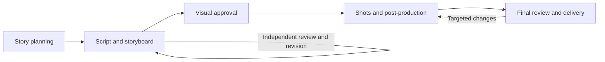
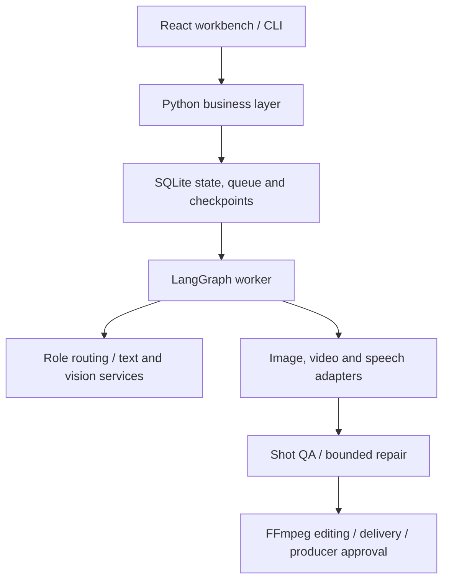

<div align="center">
  
  <h1>AI Studio</h1>
  <p><strong>From story to screen. Every creative step in view.</strong></p>
  <p>Multi-model short-drama production · From story planning to producer approval</p>
  <p><a href="README.md">简体中文</a> · <strong>English</strong></p>
  <p>
    <a href="https://github.com/Xiiiing/ai-studio/actions/workflows/ci.yml"></a>
    <a href="docs/DEPLOYMENT.md"></a>
    <a href="package.json"></a>
    <a href="CONTRIBUTING.md"></a>
  </p>
  <p>
    <a href="#quick-start">Quick start</a> ·
    <a href="docs/README.en.md">Documentation</a> ·
    <a href="docs/GETTING_STARTED.en.md">Model setup</a><br>
    <a href="https://github.com/Xiiiing/ai-studio/issues">Report an issue</a> ·
    <a href="#citation">Citation</a>
  </p>
</div>


AI Studio brings planning, screenwriting, independent review, storyboarding, visuals, speech and editing into a **recoverable, traceable production workflow**. Assign your own models or APIs to each role, inspect artifacts and review notes, make key decisions, and approve the final cut.

It is designed for creators assembling a complete short-drama pipeline and developers exploring agent collaboration, human decisions and media-task recovery. The web workbench and CLI share project state and a persistent queue; closing the browser does not discard background tasks.

## Preview


<details>
<summary><strong>View the project workflow and step details</strong></summary>


</details>

*These are captures of the actual interface with isolated mock data, not real model output or production-quality evidence. The application UI is currently Chinese and branded “映序”. [Asset provenance and reproduction](docs/assets/README.md)*

## Features

| Capability | What you can do |
| --- | --- |
| Models assigned by role | Configure writers, independent reviewers, storyboard directors, visual critics and an executive producer; inspect the actual model and execution receipt. |
| Recoverable workflows | Persist checkpoints, decisions and tasks with LangGraph + SQLite; resume interrupted work and repair individual shots within limits. |
| Inspectable creative work | Navigate five production stages and read Markdown, JSON, prompts, requests, responses and media. |
| Two-level asset libraries | Reuse characters, locations, styles and image versions across projects or within a drama; lock approved references for production. |
| Flexible production engines | Combine your text services, ComfyUI and Qwen3-TTS with supported cloud image, speech and video APIs. |
| Deliverables and final approval | Preserve MP4, subtitles, timelines, scripts, storyboards and production manifests; distinguish the first cut from producer-approved delivery. |



By default, an executive producer agent selects eligible story and visual directions; guided mode lets you make those choices yourself. Automatic revision is bounded by review rounds, attempts and budgets. Final approval, budget increases and new paid batches require the producer's decision.

## Quick start

Use **Linux and Python 3.12**. **Node.js 24** is recommended for source builds, matching CI. The control layer needs no GPU; cloud production needs your own service accounts, while local production needs compatible models and runtimes. See [deployment dependencies (Chinese)](docs/DEPLOYMENT.md) for media and subtitle requirements.

### 1. Install

```bash
git clone https://github.com/Xiiiing/ai-studio.git
cd ai-studio
python3.12 scripts/bootstrap.py
```

Bootstrap creates the control environment, builds the UI and initializes an **empty configuration** only if none exists. It preserves existing configuration and does not download models or connect to the developer's servers.

### 2. Start

Run these in separate terminals:

```bash
# Terminal A: workbench and business API
envs/factory/bin/python -m factory.web
```

```bash
# Terminal B: background task worker
envs/factory/bin/python -m factory.worker
```

Open [http://127.0.0.1:8787/](http://127.0.0.1:8787/). Persistent services and remote access are covered in [deployment, upgrades and recovery (Chinese)](docs/DEPLOYMENT.md).

### 3. Connect models and create a short drama

1. In “模型与连接” (Models and connections), enter your endpoints, actual model IDs and capabilities, then assign models to creative and review roles.
2. Configure image, speech and video connections for your production route. Save, test text connections and check media configuration. A successful check does not prove generation works.
3. Create a project with a brief, visual and motion settings, and budgets. Inspect workflow artifacts, respond to pending actions and approve the final cut.

Keep API keys in the Git-ignored `config/runtime.env`; configuration stores environment-variable names. See the [English getting-started guide](docs/GETTING_STARTED.en.md) and [complete provider guide (Chinese)](docs/USER_MODELS.md).

<details>
<summary><strong>CLI example: a 60-second motion-comic project</strong></summary>

Configure models first, then run:

```bash
./drama run \
  --brief "An original neighborhood mystery with two adult characters and few locations. Open with a hook and resolve the twist within the film. Use motion-comic visuals and voice-over." \
  --title "Neighborhood mystery" \
  --format motion_comic \
  --seconds 60 \
  --gpu-minutes 120 \
  --wall-minutes 180 \
  --max-attempts 3 \
  --request-id first-episode
```

Use `./drama status PROJECT_ID` to inspect progress and `./drama outputs PROJECT_ID` to list deliverables. Replace `PROJECT_ID` with the returned ID. See the [guide](docs/GETTING_STARTED.en.md) for manual decisions, recovery and configuration export.

</details>

## Models and production routes

| Stage | Implemented integrations | Details |
| --- | --- | --- |
| Text and visual understanding | llama.cpp, Ollama, vLLM, LM Studio; OpenAI-compatible and supported provider-specific protocols | [Model capabilities (Chinese)](docs/MODEL_PROVIDERS.md) |
| Images | Managed or user-hosted ComfyUI; supported Alibaba Cloud Bailian image APIs | [Provider setup (Chinese)](docs/USER_MODELS.md) |
| Video | ComfyUI / Wan, custom ComfyUI API workflows; supported MiniMax image-to-video API | [Model and workflow configuration (Chinese)](docs/MODEL_PROVIDERS.md) |
| Speech | Separate Qwen3-TTS process on the production machine; supported Bailian speech API | [Local and cloud speech (Chinese)](docs/USER_MODELS.md) |
| Post-production | FFmpeg / PyAV editing, mixing, subtitles and media inspection | [Deployment dependencies (Chinese)](docs/DEPLOYMENT.md) |

**Motion comics** use keyframes and procedural camera motion. **2D animation and live-action routes** use image-to-video generation and need shot-by-shot validation. Synchronized lip movements and commercial artistic quality are not guaranteed. Model IDs, protocols, vision support, regions and account permissions must be checked separately; arbitrary provider endpoints are not interchangeable.

## Architecture and repository map



Model services can run locally, on a LAN or remotely. `localhost` refers to the backend machine. Actual configuration determines where the control layer, worker, state and production resources run; see the [architecture guide (Chinese)](docs/ARCHITECTURE.md).

| Path | Contents |
| --- | --- |
| [`factory/`](factory/) | Workflows, role routing, project state, APIs and background worker |
| [`ui/factory/`](ui/factory/) | React + TypeScript producer workbench |
| [`studio/`](studio/) · [`audio/`](audio/) | Media production, editing and local speech |
| [`config/`](config/) · [`workflows/`](workflows/) | Public configuration examples and production workflow templates |
| [`scripts/`](scripts/) · [`deploy/`](deploy/) | Bootstrap, operations tools and service templates |
| [`tests/`](tests/) · [`evaluation/`](evaluation/) | Workflow, UI and browser contracts; offline creative evaluation |
| [`docs/`](docs/README.en.md) | Documentation grouped by usage, development, operations and history |

Private configuration, keys, databases, weights, environments and generated media stay outside Git. See [contribution guidelines](CONTRIBUTING.md).

## Documentation and contributing

| Goal | Start here |
| --- | --- |
| First use | [English getting started](docs/GETTING_STARTED.en.md) · [Provider setup (Chinese)](docs/USER_MODELS.md) |
| Production and revision | [Short-drama contract](docs/SHORT_DRAMA_CONTRACT.md) · [Asset library](docs/MATERIAL_LIBRARY.md) · [Shot workbench](docs/SHOT_WORKBENCH.md) — Chinese |
| Development | [Architecture](docs/ARCHITECTURE.md) · [API](docs/API.md) — Chinese; [contribution and validation guide](CONTRIBUTING.md) — bilingual |
| Operations | [Deployment](docs/DEPLOYMENT.md) · [Consistent backup](docs/CONSISTENT_BACKUP.md) · [HTTP boundaries](docs/HTTP_SECURITY.md) — Chinese |
| All documentation | [English index](docs/README.en.md) · [中文文档中心](docs/README.md) |

Report reproducible bugs and discuss ideas in [Issues](https://github.com/Xiiiing/ai-studio/issues), or contribute through [Pull requests](https://github.com/Xiiiing/ai-studio/pulls). Read [CONTRIBUTING.md](CONTRIBUTING.md) for setup, validation and change scope.

## Operational limits

- Connection probes and configuration checks establish only the checks performed. Generation, visual understanding and artistic quality require actual calls.
- Paid image, speech and video batches have authorization and cost records. Application allowances are not hard limits on provider billing; text APIs have no monetary hard cap.
- The workbench binds to loopback by default and targets single-user production. Remote access needs SSH forwarding or an authenticated proxy.
- Automated validation uses isolated data and mock providers. Historical tests, deployment-specific results and real inference evidence are documented separately in the [index](docs/README.en.md).

## Acknowledgments and sources

Execution and UI build on [LangGraph](https://github.com/langchain-ai/langgraph), [React](https://github.com/facebook/react) and [TanStack Query](https://github.com/TanStack/query). Media integrations use [ComfyUI](https://github.com/Comfy-Org/ComfyUI), [Qwen3-TTS](https://github.com/QwenLM/Qwen3-TTS), [FFmpeg](https://ffmpeg.org/) and [PyAV](https://github.com/PyAV-Org/PyAV).

Product and architecture references include [Dify](https://github.com/langgenius/dify), [Langflow](https://github.com/langflow-ai/langflow), [Toonflow](https://github.com/HBAI-Ltd/Toonflow-app), [MoneyPrinterTurbo](https://github.com/harry0703/MoneyPrinterTurbo) and [Drama Skills](https://github.com/zenstory-ai/drama-skills). References and runtime dependencies are documented separately in [architecture research](docs/REFERENCE_ARCHITECTURES.md) and [third-party notices](THIRD_PARTY_NOTICES.md).

## Citation

If you use the project in research, articles or creative work, cite the repository and record the commit used. Metadata is available in [CITATION.cff](CITATION.cff) and GitHub's “Cite this repository” menu.

```bibtex
@misc{ai_studio,
  author       = {Xiiiing},
  title        = {{AI Studio}: Multi-model short-drama production workflows},
  howpublished = {\url{https://github.com/Xiiiing/ai-studio}},
  note         = {Software repository; record the commit used}
}
```

## License

The repository **does not currently specify a unified source-code license**. Public hosting alone does not grant unrestricted permission to use, modify or redistribute it. Third-party components, model weights and services retain their own terms; see [THIRD_PARTY_NOTICES.md](THIRD_PARTY_NOTICES.md).
