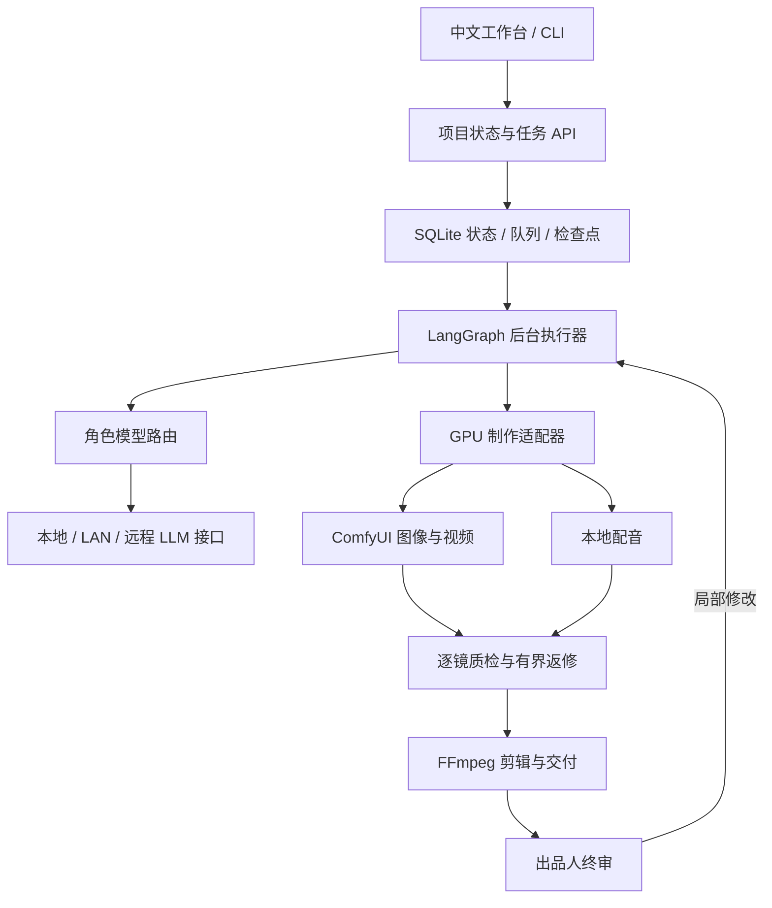

# AI Studio · 多模型短剧工作流

让不同模型分别负责故事策划、编剧、审稿、分镜和画面质检，用本地制作引擎完成图像、视频、配音、剪辑与交付。

**AI Studio 的核心是一条可恢复的制作工作流。** 出品人主要选择故事、选择视觉方案、审阅初版成片；普通的结构修复、镜头重试和预算检查由执行器处理。CLI 和中文工作台共用同一套状态与任务队列。

## 这版解决什么问题

- **模型通过接口调用。** 同一角色可配置 llama.cpp、Ollama、vLLM 或 OpenAI-compatible 服务；模型服务可以在本机、明确配置的局域网地址或远程 HTTPS 地址。
- **角色和模型分开。** 编剧、独立审稿、分镜导演、视觉质检有各自绑定；多个角色共用模型时也会明确显示。
- **配置可查看、测试、导出和保存。** 连接测试只读取模型列表，不生成内容。配置用版本校验保存；已开始的执行批次持有自己的快照。
- **工作流可中断和恢复。** LangGraph + SQLite 保存状态；后台 worker 执行长任务，关闭页面不丢失任务。
- **制作按镜头追踪。** 保存参考图、提示词、模型身份、参数、生成任务 ID、质检和修复回执，复用仍有效的素材。
- **输出完整交付。** MP4、字幕、时间线、剧本、分镜和制作清单保存在制作工程中；初版生成和出品人终审是两个状态。

## 模型究竟怎样运行和调用

| 环节 | 当前调用接口 | 模型在哪里运行 |
| --- | --- | --- |
| 策划、编剧、审稿、导演、视觉理解 | OpenAI-compatible HTTP，主要使用 `/v1/chat/completions` | 独立 llama.cpp / Ollama / vLLM 服务，或显式配置的远程服务 |
| 图像、视频 | ComfyUI HTTP，提交 `/prompt` 后按 `prompt_id` 查询历史 | 本机受 GPU 租约管理的 ComfyUI 进程 |
| 角色配音 | 受控本地进程，结构化输入、WAV 和回执 | 独立 Qwen3-TTS Python 环境 |
| 剪辑、混音、字幕、媒体检查 | 本地 FFmpeg / PyAV | 本机 CPU |

本地运行是部署位置，HTTP 是调用协议，两者可以同时成立。主程序不会把全部 LLM 权重加载到自身进程，也不会通过模型设置执行任意安装或启动命令。视频异步任务和配音进程保留各自的执行语义。

默认制作路线为动态漫：关键帧、程序运镜、配音、字幕与剪辑。真人和二维动画路线使用图生视频，实际质量仍需要逐镜质检。默认不启用 DSPy、VBench，也不把完整真人短剧的艺术质量当成已保证的能力。

## 快速开始

控制层适合 Linux + Python 3.12。只使用文本创作或远程 LLM 接口时，控制层无需 GPU；本地图像、视频和配音需要另外准备对应模型、运行环境与显存。

```bash
git clone https://github.com/Xiiiing/ai-studio.git
cd ai-studio
python3.12 scripts/bootstrap.py
./drama models
./drama workflow --json
```

初始化仅在缺失时创建 `config/factory.json`，保留已有配置。公开示例中的模型 ID 是示例别名，需改成你的服务实际提供的 ID。Ollama、vLLM、远程连接示例默认禁用。

启动工作台和后台执行器，分别在两个终端运行：

```bash
envs/factory/bin/python -m factory.web
```

```bash
envs/factory/bin/python -m factory.worker
```

浏览器打开 **http://127.0.0.1:8787/**。服务器部署可通过 SSH 转发这个端口。长期运行使用[部署说明](docs/DEPLOYMENT.md)中的 systemd 安装方式。

### 配置模型

进入工作台的“模型与连接”：

1. 添加或编辑连接，填写服务类型、地址、服务端模型 ID、上下文和能力。
2. 点击“测试连接”，核对模型列表和 ID。
3. 为各个角色选择模型，视觉质检必须绑定支持视觉输入的配置。
4. 显式保存配置。保存不开始生产，也不会自动下载或启动模型。

也可使用 CLI：

```bash
./drama roles
./drama models probe writer_local
./drama models export --file runtime/models-edit.json
# 编辑导出文件中的 llm_profiles 和 llm_roles
./drama models apply --file runtime/models-edit.json
```

导出文件保留配置版本；其他页面已修改配置时，旧文件会被拒绝，先重新导出再修改。真实密钥只放在服务环境变量中，配置仅保存 `api_key_env` 名称。详见[模型接口说明](docs/MODEL_PROVIDERS.md)。

### 提交创作任务

```bash
./drama run \
  --brief "原创邻里悬疑，两个成年角色、少量场景，开场有钩子，结尾完成反转，适合动态漫和画外音。" \
  --title "邻里悬疑" \
  --format motion_comic \
  --seconds 60 \
  --gpu-minutes 120 \
  --wall-minutes 180 \
  --max-attempts 3 \
  --request-id first-episode
```

工作流到达决策点后，工作台会展示可选内容。CLI 可用：

```bash
./drama status PROJECT_ID
./drama choose PROJECT_ID --type story --choice PROPOSAL_ID --decision-id STORY_GATE_ID
./drama choose PROJECT_ID --type style --choice STYLE_ID --decision-id STYLE_GATE_ID
./drama outputs PROJECT_ID
```

实际编号来自 `status`，不要使用上述占位符。制作中可请求暂停并在安全边界恢复；详情页提供预算、失败原因、镜头状态和局部返修。终审也可以选择修改，并给出反馈。

## 架构



工作流图的程序化导出来自实际 LangGraph 图，并不是另一套编辑器的演示拓扑。当前提供固定的短剧制作流程与可配置的角色模型绑定；导出的图说明不能用来导入任意可执行代码。

| 代码位置 | 职责 |
| --- | --- |
| `factory/providers.py` | 模型协议、连接目录、网络范围、配置校验与保存 |
| `factory/llm.py` | 角色调用、结构化输出、上下文预算、回执 |
| `factory/workflows.py` | 持久化执行图与人工决策 |
| `factory/creative.py`、`storyboard.py` | 编剧、独立评审、分镜和反馈处理 |
| `factory/production.py`、`scheduler.py` | 镜头生产、GPU 租约、预算、失败恢复 |
| `factory/web.py`、`ui/factory/` | 中文工作台和业务 API |
| `studio/`、`audio/` | 制作、媒体和配音适配器 |
| `config/factory.example.json` | 可移植配置示例 |

## 从哪些项目学习

参考 Dify 的供应商与模型能力分离、Langflow 的流程 API 和配置导出、Toonflow 的角色/场景/镜头组织、MoneyPrinterTurbo 的完整视频交付、ComfyUI 的异步执行、Drama Skills 的创作职责和内容阅读界面。

这些是架构与产品设计依据；项目没有把上述平台全部安装并串成多重调度系统。具体框架、采用原则、当前官方来源和许可边界见[参考架构研究](docs/REFERENCE_ARCHITECTURES.md)和[第三方说明](THIRD_PARTY_NOTICES.md)。

## 验证与边界

- CPU 测试覆盖角色路由、连接配置、网络约束、结构化输出、状态恢复、决策重放、镜头返修和 UI 接口。
- 连接测试证明服务可达、模型 ID 对应；它不证明模型的编剧质量、视觉能力或全部 schema 兼容性。
- 不同后端仍需使用实际 schema 和小规模图像输入验收。模型版本、GPU 和服务参数变化时应重新验证。
- 生产预算目前约束 GPU 时间、制作墙钟时间和尝试次数；外部 API 的 token 用量写入回执，尚未提供按货币金额的硬限额。
- 默认工作台绑定本机回环地址，定位是单机出品人工具。互联网多人访问需要另外配置认证代理，不能直接把本机接口开放到公网。
- 权重、私有配置、API 密钥、数据库、生产素材和历史生成回执不在源码仓库中。模型下载与模型许可独立于源码。

```bash
envs/factory/bin/python -m pytest -q tests/test_factory_*.py
```

## 文档

- [模型接口与本地运行](docs/MODEL_PROVIDERS.md)
- [部署、升级和恢复](docs/DEPLOYMENT.md)
- [API 与工作流配置](docs/API.md)
- [参考架构研究](docs/REFERENCE_ARCHITECTURES.md)
- [第三方组件说明](THIRD_PARTY_NOTICES.md)
