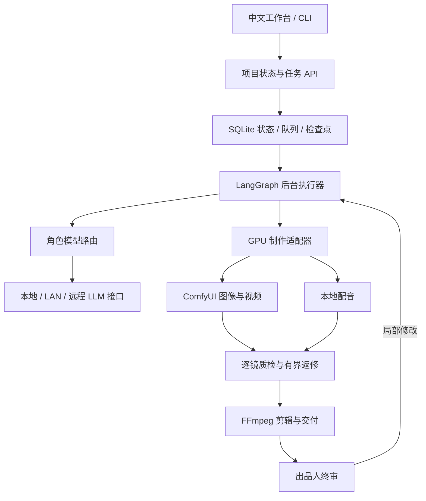

# AI Studio · 多模型短剧工作流

让不同模型分别负责故事策划、编剧、审稿、分镜和画面质检，组合本地图像、配音与剪辑，以及本地或云端视频生成，完成短剧交付。

**AI Studio 的核心是一条可恢复的制作工作流。** 新项目默认由总制片代理选择合格故事与视觉方向，出品人可在安全边界接管，并负责初版成片的终审；普通修复在既有尝试与预算内执行。CLI 和中文工作台共用同一套状态与任务队列。

## 这版解决什么问题

- **制作台与团队指挥连通。** 浅深主题制片总览展示实际执行、待办和作品；项目按故事、视觉、分镜、镜头与成片组织内容，Agent 任务直接关联产物与独立审核。
- **桌面与手机使用同一制作能力。** 工作台支持跟随系统、浅色、深色三种外观。桌面项目内容分组展示，手机从当前页面入口选择全部十个页面；导航、弹窗和流程详情支持键盘操作及减少动态效果。项目搜索覆盖全部项目。
- **待办有实际处理方式。** 补充授权素材、切回原创、修改方向、反馈后重新审核、全部否决视觉及指定镜头返修，共用服务端动作契约。
- **执行图按项目版本恢复。** 新项目分别保存故事目标、剧本、分镜、独立审核和视觉设计步骤；已有项目使用原检查点。旧 UI、旧启动器及固定样片专项验收入口已删除。

- **模型通过接口调用。** 同一角色可配置 llama.cpp、Ollama 原生或兼容接口、vLLM、LM Studio、DeepSeek、百炼或其他 OpenAI-compatible 服务；部署位置与协议分开配置。
- **角色和模型分开。** 编剧、独立审稿、分镜导演、视觉质检有各自绑定；多个角色共用模型时也会明确显示。
- **团队工作数据流可查看。** 每个项目展示当前角色分配、任务状态、输入输出、上下游交接，以及当次实际模型的执行回执。总控沿现有工作流分工，用户可调整角色绑定。
- **视频引擎可选择。** `video_generator` 可以绑定 ComfyUI / MiniMax H3、已有 Wan 或 MiniMax 云端视频接口；cami 新配置使用 Wkp 原有 H3 双卡链路。云端任务按 ID 持久化并恢复查询、下载，再进入现有逐镜质检和剪辑。
- **配置可查看、测试、导出和保存。** 文本连接可以探测模型列表；显式跳过发现和视频连接只做配置预检，不生成内容。配置用版本校验保存；已开始的执行批次持有自己的快照。
- **工作流可中断和恢复。** LangGraph + SQLite 保存状态；后台 worker 执行长任务，关闭页面不丢失任务。
- **制作按镜头追踪。** 保存参考图、提示词、模型身份、参数、生成任务 ID、质检和修复回执，复用仍有效的素材。
- **人物、场景与画风可复用。** 统一素材库和剧内素材库支持上传、多图版本、AI 素材制作与全剧定稿，固定参考实际参与编剧、分镜和首帧生成。见[素材库使用说明](docs/MATERIAL_LIBRARY.md)。
- **输出完整交付。** MP4、字幕、时间线、剧本、分镜和制作清单保存在制作工程中；初版生成和出品人终审是两个状态。

## 模型究竟怎样运行和调用

| 环节 | 当前调用接口 | 模型在哪里运行 |
| --- | --- | --- |
| 策划、编剧、审稿、导演、视觉理解 | OpenAI-compatible Chat Completions 或 Ollama 原生 `/api/chat` | 本机、LAN 或远程模型服务，按角色配置 |
| 图像 | ComfyUI HTTP，提交 `/prompt` 后按 `prompt_id` 查询历史 | 本机受 GPU 租约管理的 ComfyUI 进程 |
| 扩散视频 | ComfyUI / MiniMax H3 或已有 Wan，或 MiniMax 云端 `video_generation` → 查询任务 → 获取文件 | 制作服务器 GPU，或显式选择的远程 HTTPS 视频服务 |
| 角色配音 | 受控本地进程，结构化输入、WAV 和回执 | 独立 Qwen3-TTS Python 环境 |
| 剪辑、混音、字幕、媒体检查 | 本地 FFmpeg / PyAV | 本机 CPU |

本地运行是部署位置，HTTP 是调用协议，两者可以同时成立。主程序不会把全部 LLM 权重加载到自身进程，也不会通过模型设置执行任意安装或启动命令。视频异步任务和配音进程保留各自的执行语义。

默认制作路线为动态漫：关键帧、程序运镜、配音、字幕与剪辑。真人和二维动画路线使用图生视频，实际质量仍需要逐镜质检。默认不启用 DSPy、VBench，也不把完整真人短剧的艺术质量当成已保证的能力。

## 快速开始

控制层适合 Linux + Python 3.12；UI 构建机需要 Node.js 24。只使用文本创作或远程 LLM 接口时，控制层无需 GPU；本地图像、视频和配音需要另外准备对应模型、运行环境与显存。

```bash
git clone https://github.com/Xiiiing/ai-studio.git
cd ai-studio
python3.12 scripts/bootstrap.py
./drama models
./drama workflow --json
```

初始化仅在缺失时创建 `config/factory.json`，保留已有配置，并将 React 工作台构建到 `ui/factory/dist`。运行服务器可安装匹配代码版本的预构建 UI，使用 `--skip-ui-build` 跳过 Node。公开示例中的模型 ID 是示例别名，需改成你的服务实际提供的 ID。Ollama、vLLM、LM Studio、DeepSeek、百炼和 MiniMax 示例连接默认禁用，启用前填写实际服务与模型 ID。

启动工作台和后台执行器，分别在两个终端运行：

```bash
envs/factory/bin/python -m factory.web
```

```bash
envs/factory/bin/python -m factory.worker
```

浏览器打开 **http://127.0.0.1:8787/**。服务器部署可通过 SSH 转发这个端口。长期运行使用[部署说明](docs/DEPLOYMENT.md)中的 systemd 安装方式。

### 配置模型

进入工作台的“模型与连接”：

1. 添加或编辑连接，填写服务类型、地址、服务端模型 ID、上下文和能力。
2. 为各个角色选择模型，视觉质检必须绑定支持视觉输入的配置。
3. 点击“保存配置”。保存不开始生产，也不会自动下载或启动模型。
4. 对已保存的连接点击“测试连接”，核对模型列表和 ID；测试失败时修改配置、重新保存后再测试。草稿不能直接进行连接测试。
5. 在“视频模型”中添加 MiniMax 连接或选择本地 Wan，为“视频生成”指定连接；点击“预检配置”检查保存的配置和密钥变量。
6. 进入项目的“制作工作流”或“团队与回执”，查看角色的输入、产物和执行记录。成员卡显示当前分配；历史回执保留当次实际模型，不随默认配置变化。

Base URL 是完整 API 前缀，不统一追加 `/v1`。例如 DeepSeek 可使用服务根，百炼保留 `/compatible-mode/v1`，Ollama 原生使用服务根或 `/api`。百炼等目录协议不同的服务可设 `model_discovery: "skip"`，预检会明确显示“未验证”，实际调用仍校验响应模型与 JSON 结构。

MiniMax 的当前适配器使用 v1 图生视频协议，支持任务、文件 ID 与可恢复下载；这不表示自动支持所有其他视频供应商或 H3 的不同协议。`motion_comic` 仍使用关键帧与程序运镜，云视频选择用于真人和二维动画路线。详见模型文档中的支持组合与恢复说明。

也可使用 CLI：

```bash
./drama roles
./drama models probe writer_local
./drama models probe minimax_example --kind video
./drama models export --file runtime/models-edit.json
# 编辑导出文件中的 llm_profiles 和 llm_roles
./drama models apply --file runtime/models-edit.json
```

导出文件保留配置版本；其他页面已修改配置时，旧文件会被拒绝，先重新导出再修改。真实密钥只放在服务环境变量中，配置仅保存 `api_key_env` 名称。详见[模型接口说明](docs/MODEL_PROVIDERS.md)。

### 阅读工作流与 Agent 输入输出

顶栏“外观主题”记住本浏览器的选择；跟随系统时随操作系统切换。手机使用左上角展开工作室导航，项目内通过当前页面名称切换制作内容。点击流程阶段进入详情，返回流程图后保留所选步骤。桌面详情在独立滚动区域阅读，切换步骤回到标题；自动刷新保留正在阅读的位置。

模型配置与逐镜编辑的草稿在本次页面会话中保留，切换页面或镜头后可继续编辑；保存期间锁定对应编辑，失败保留修改。草稿不写入浏览器持久存储，刷新或关闭页面前会提醒存在未保存内容。服务器版本变化后需要核对草稿，不能直接覆盖新版本。

项目首页使用固定布局流程图展示故事策划、剧本与分镜、视觉确认、镜头与后期、终审交付五个阶段。节点端口和方向箭头表达真实拓扑中的数据流向，执行中的阶段显示流动线与流动点，返修使用金色连线；无需缩放或平移。点击阶段在右侧查看真实子步骤、输入材料、交付内容、参与角色与执行记录；窄屏点击后直接定位下方详情，并可返回流程图。暂停和等待人工处理时动效停止，减少动态效果设置会关闭动画。自动刷新保留手动选择和正在阅读的文件。

输入与输出文件均可点击“阅读文件”。Markdown 支持标题、表格、列表和代码块，JSON 可切换正文与原文；支持放大阅读、媒体预览和下载。文本预览上限为 2 MiB，超限时下载阅读；文件缺失或读取失败可重试。

“执行记录”按调用及重试次数展示已保存的请求、响应、解析结果和回执，包括提示词与消息原文。当前业务材料与当次模型输入分别展示；旧调用缺少步骤归属时标为角色历史，不推测所属步骤。团队页中的执行记录可定位回对应步骤。查看内容不会启动生成或改变终审决定。

### 提交创作任务

```bash
./drama run \
  --brief "原创邻里悬疑，两个成年角色、少量场景，开场有钩子，结尾完成反转，适合动态漫和画外音。" \
  --title "邻里悬疑" \
  --format motion_comic \
  --seconds 60 \
  --gpu-minutes 120 \
  --wall-minutes 180 \
  --max-attempts 3 \
  --request-id first-episode
```

工作流需要人工处理时，工作台展示候选、审核依据和有效操作。新项目默认 AI 代管故事与视觉；总制片未配置时明确回到人工处理。创建时使用 `--team-mode guided` 可全程人工选择故事与画风。

审核待办可以直接选择“按全部审核建议修改”、具体问题或当前阶段的常用修改方向，再确认提交，无需填写文字；也可保留选项并补充自定义要求。视觉重新生成和成片返修、重剪同样支持选项。选择表达修改重点，作品仍需通过独立审核；页面更新时会保留已选要求，并在版本冲突后要求核对再提交。

创作审核默认每批最多 4 轮（3 次自动返修）：审稿人指出问题，创作角色按原稿和意见重做，再送独立审核，通过后继续。超过上限时保留历史，由已配置的总制片模型分析返修方案、理由、风险和需要你决定的取舍；也可点击“请 AI 分析并推荐”。你可以采纳 AI 方案继续一批返修，或使用自己的审核选项。终片确认、预算增加和新增费用授权由你决定。`creative.max_review_rounds` 支持 1–6，旧配置的显式上限继续有效。

CLI 可用：

```bash
./drama status PROJECT_ID
./drama choose PROJECT_ID --type story --choice PROPOSAL_ID --decision-id STORY_GATE_ID
./drama choose PROJECT_ID --type style --choice STYLE_ID --decision-id STYLE_GATE_ID
./drama outputs PROJECT_ID
```

实际编号来自 `status`，不要使用上述占位符。制作中可请求暂停并在安全边界恢复；详情页提供预算、失败原因、镜头状态和局部返修。终审也可以选择修改，并给出反馈。

## 架构

当前测试部署采用 **cami 控制层 + Wkp 推理服务**：前端、业务 API、项目库、Agent 编排、工作流 worker 和剪辑全部在 cami；Wkp 只执行模型推理。只迁移系统，不迁移旧数据。详见 [部署与唯一测试入口](docs/CAMI_CONTROL_PLANE.md)。



工作流图的程序化导出来自实际 LangGraph 图，并不是另一套编辑器的演示拓扑。当前提供固定的短剧制作流程与可配置的角色模型绑定；导出的图说明不能用来导入任意可执行代码。

| 代码位置 | 职责 |
| --- | --- |
| `factory/providers.py` | 模型协议、连接目录、网络范围、配置校验与保存 |
| `factory/llm.py` | 角色调用、结构化输出、上下文预算、回执 |
| `factory/workflows.py` | 持久化执行图与人工决策 |
| `factory/creative.py`、`storyboard.py` | 编剧、独立评审、分镜和反馈处理 |
| `factory/production.py`、`scheduler.py` | 镜头生产、GPU 租约、预算、失败恢复 |
| `factory/video_providers.py`、`video_transport.py`、`minimax_video.py`、`video_production.py` | 视频连接、受限网络、持久化云任务与逐镜生产接入 |
| `factory/team_flow.py` | 当前分工、产物流转和有界历史回执投影 |
| `factory/web.py`、`ui/factory/` | 中文工作台和业务 API |
| `studio/`、`audio/` | 制作、媒体和配音适配器 |
| `config/factory.example.json` | 可移植配置示例 |

## 从哪些项目学习

参考 Dify 的供应商与模型能力分离、Langflow 的流程 API 和配置导出、Toonflow 的角色/场景/镜头组织、MoneyPrinterTurbo 的完整视频交付、ComfyUI 的异步执行、Drama Skills 的创作职责和内容阅读界面。

这些是架构与产品设计依据；项目没有把上述平台全部安装并串成多重调度系统。具体框架、采用原则、当前官方来源和许可边界见[参考架构研究](docs/REFERENCE_ARCHITECTURES.md)和[第三方说明](THIRD_PARTY_NOTICES.md)。

## 验证与边界

- CPU 测试覆盖角色路由、连接配置、网络约束、结构化输出、状态恢复、决策重放、镜头返修和 UI 接口。
- 成功的文本模型目录探测证明该接口可达、模型 ID 对应；`unverified` 和视频的 `configured` 只表示配置状态。生成质量、视觉能力和 schema 兼容性仍由实际调用确认。
- 不同后端仍需使用实际 schema 和小规模图像输入验收。模型版本、GPU 和服务参数变化时应重新验证。
- 生产预算目前约束 GPU 时间、制作墙钟时间和尝试次数；外部 API 的 token 用量写入回执，尚未提供按货币金额的硬限额。
- 默认工作台绑定本机回环地址，定位是单机出品人工具。互联网多人访问需要另外配置认证代理，不能直接把本机接口开放到公网。
- 权重、私有配置、API 密钥、数据库、生产素材和历史生成回执不在源码仓库中。模型下载与模型许可独立于源码。

```bash
envs/factory/bin/python -m pytest -q tests/test_factory_*.py
npm test
npm run build
python scripts/browser_fixtures.py
FACTORY_TEST_PYTHON=envs/factory/bin/python npm run test:browser
```

## 文档

- [0.0.2 工作台主题与多屏体验](docs/UI_REDESIGN_0_0_2.md)
- [0.0.3 部署后布局、深色与手机操作修正](docs/UI_DEPLOYED_REFINEMENT.md)
- [模型接口与本地运行](docs/MODEL_PROVIDERS.md)
- [部署、升级和恢复](docs/DEPLOYMENT.md)
- [API 与工作流配置](docs/API.md)
- [工作台重构、迁移与验证](docs/STUDIO_UPGRADE_2026-10-15.md)
- [此前问题、修复与验证范围](docs/AUDIT_2026-10-13.md)
- [参考架构研究](docs/REFERENCE_ARCHITECTURES.md)
- [第三方组件说明](THIRD_PARTY_NOTICES.md)

## 使用自己的模型或购买 API

Linux 用户可自行安装，通过“模型与连接”中的平台预设配置自己的服务。普通用户可以使用百炼图像／配音与 MiniMax 视频完成无需本机 GPU 的制作，也可混合使用本地文本、ComfyUI 和 Qwen3-TTS。新安装从空配置开始，不依赖开发者的 Wkp。密钥继续使用私有环境变量。

配置步骤、模型支持范围、工作流导入和费用恢复说明见 [用户模型接入指南](docs/USER_MODELS.md)。纯 API 配置结构参考 `config/factory.api.example.json`；实际模型、地域、工作空间和密钥由使用者准备。
