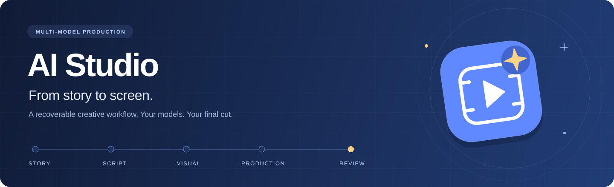
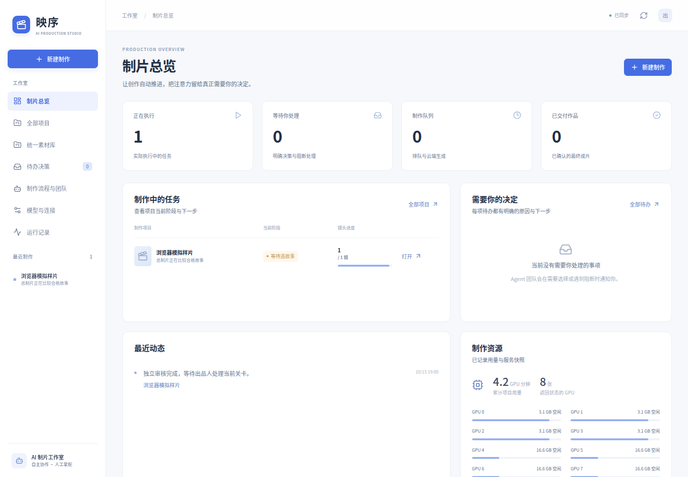
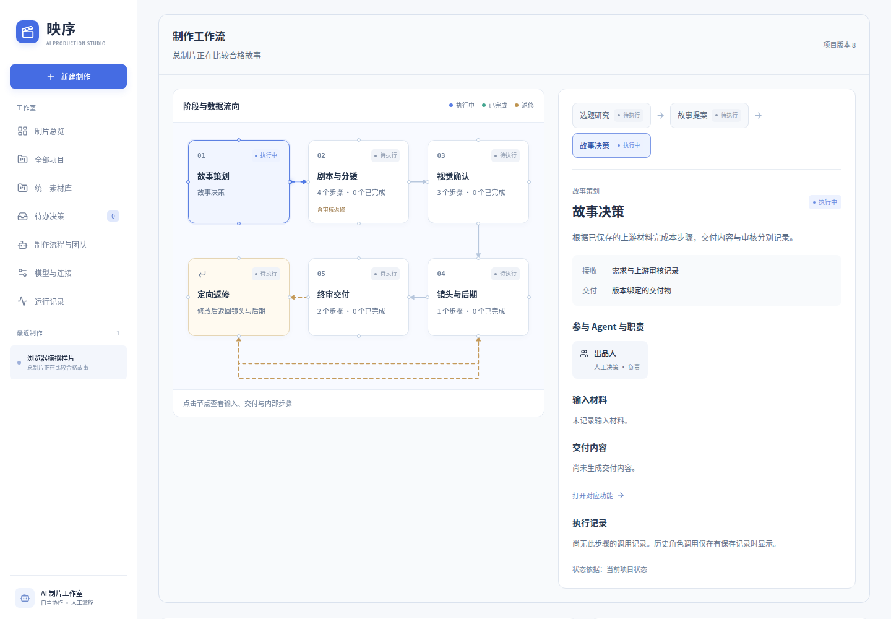
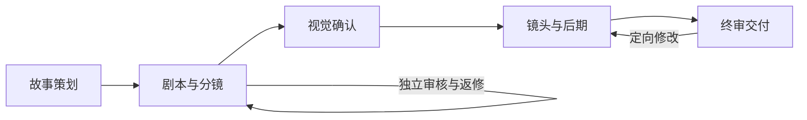
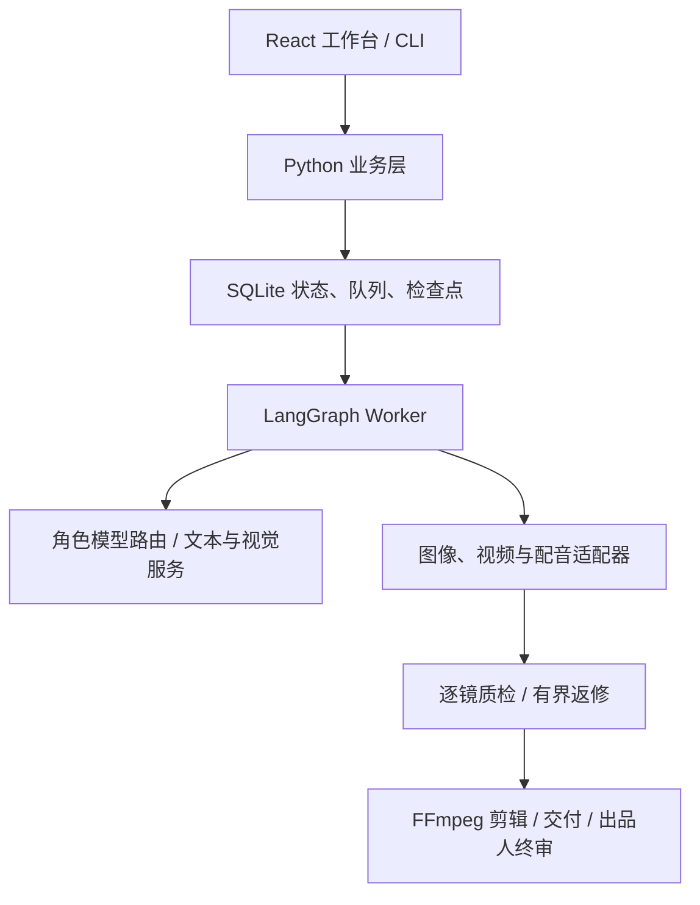

<div align="center">
  
  <h1>AI Studio</h1>
  <p><strong>让故事走向银幕，让创作过程可见。</strong></p>
  <p>多模型协作的短剧制作工作室 · 从故事策划到出品人终审</p>
  <p><strong>简体中文</strong> · <a href="README.en.md">English</a></p>
  <p>
    <a href="https://github.com/Xiiiing/ai-studio/actions/workflows/ci.yml"></a>
    <a href="docs/DEPLOYMENT.md"></a>
    <a href="package.json"></a>
    <a href="CONTRIBUTING.md"></a>
  </p>
  <p>
    <a href="#快速开始">快速开始</a> ·
    <a href="docs/README.md">文档中心</a> ·
    <a href="docs/USER_MODELS.md">模型接入</a><br>
    <a href="https://github.com/Xiiiing/ai-studio/issues">问题反馈</a> ·
    <a href="#引用项目">引用项目</a>
  </p>
</div>



AI Studio（工作台名称「映序」）将策划、编剧、独立审稿、分镜、视觉、配音和剪辑组织成一条**可恢复、可追溯的制作工作流**。你可以为不同角色选择自己的模型或 API，在工作台查看产物与审核意见，处理关键决策，最终确认成片。

适合想把多个模型接成完整短剧流程的创作者，也适合研究 Agent 分工、人工决策与媒体任务恢复的开发者。Web 工作台和 CLI 共用项目状态与任务队列；关闭页面不会丢失后台任务。

## 界面预览



<details>
<summary><strong>查看项目工作流与步骤详情</strong></summary>



</details>

*以上为真实界面的隔离模拟数据截图，用于展示产品布局，不代表真实模型生成效果。当前应用界面为中文。[资源来源与复现说明](docs/assets/README.md)*

## 核心能力

| 能力 | 你可以做什么 |
| --- | --- |
| 多角色模型协作 | 分别配置编剧、独立审稿、分镜导演、视觉质检与总制片；查看当次实际模型和执行回执。 |
| 可恢复的工作流 | 用 LangGraph + SQLite 保存检查点、决策与任务；中断后接续，按镜头进行有界返修。 |
| 可读的创作过程 | 在五阶段流程图中查看真实步骤，打开 Markdown、JSON、提示词、请求响应与媒体。 |
| 两层素材库 | 管理跨项目及剧内的人物、场景、画风与多图版本，定稿后作为实际制作参考。 |
| 灵活的制作引擎 | 混合自己的文本服务、ComfyUI、Qwen3-TTS，以及已适配的云端图像、语音和视频 API。 |
| 明确的交付与终审 | 保存 MP4、字幕、时间线、剧本、分镜与制作清单；初版生成后由出品人确认终版。 |



创作默认由总制片代理选择合格的故事与视觉方向，也可使用人工引导模式。自动返修受轮次、尝试次数和预算约束；终片确认、预算增加和新增付费授权仍由出品人决定。

## 快速开始

需要 **Linux、Python 3.12**；从源码构建工作台建议 **Node.js 24**（与 CI 一致）。控制层本身不需要 GPU；云端路线需要自己的服务账号，本地制作需要相应模型与运行环境。媒体与字幕依赖见[部署说明](docs/DEPLOYMENT.md)。

### 1. 安装

```bash
git clone https://github.com/Xiiiing/ai-studio.git
cd ai-studio
python3.12 scripts/bootstrap.py
```

初始化会创建控制环境、构建 UI，并在配置缺失时使用**空配置**；不会下载模型或自动连接开发者的服务器。已有配置会保留。

### 2. 启动

分别在两个终端运行：

```bash
# 终端 A：工作台与业务 API
envs/factory/bin/python -m factory.web
```

```bash
# 终端 B：后台任务执行器
envs/factory/bin/python -m factory.worker
```

打开 [http://127.0.0.1:8787/](http://127.0.0.1:8787/)。长期运行与远程访问见[部署、升级与恢复](docs/DEPLOYMENT.md)。

### 3. 接入模型，创建第一部短剧

1. 在“模型与连接”中配置自己的服务地址、实际模型 ID 和能力，为创作与审核角色分配连接。
2. 按制作路线配置图像、配音和视频；保存后测试文本连接、检查媒体配置。检查通过不等于已经生成成功。
3. 新建项目，填写创作方向、画面与运动方式和预算；在工作流中查看产物，处理待办并确认终片。

API 密钥放入被 Git 忽略的 `config/runtime.env`；配置仅保存密钥变量名。完整步骤见[首次使用指南](docs/GETTING_STARTED.md)与[使用自己的模型和 API](docs/USER_MODELS.md)。

<details>
<summary><strong>CLI 示例：创建一个 60 秒动态漫项目</strong></summary>

先完成模型配置，再运行：

```bash
./drama run \
  --brief "原创邻里悬疑，两个成年角色、少量场景，开场有钩子，结尾完成反转，适合动态漫和画外音。" \
  --title "邻里悬疑" \
  --format motion_comic \
  --seconds 60 \
  --gpu-minutes 120 \
  --wall-minutes 180 \
  --max-attempts 3 \
  --request-id first-episode
```

返回项目 ID 后，用 `./drama status PROJECT_ID` 查看进度，`./drama outputs PROJECT_ID` 查看交付物。`PROJECT_ID` 需替换为实际编号；人工选择、暂停恢复和配置导出见[使用指南](docs/GETTING_STARTED.md)。

</details>

## 模型与制作路线

| 环节 | 已实现的接入方式 | 进一步阅读 |
| --- | --- | --- |
| 文本与视觉理解 | llama.cpp、Ollama、vLLM、LM Studio；OpenAI-compatible 及已适配的平台协议 | [模型接口与能力](docs/MODEL_PROVIDERS.md) |
| 图像 | 托管或用户自建的 ComfyUI；已适配的百炼图像 API | [用户模型指南](docs/USER_MODELS.md) |
| 视频 | ComfyUI / Wan、自定义 ComfyUI API 工作流；MiniMax 已适配图生视频接口 | [模型与工作流配置](docs/MODEL_PROVIDERS.md) |
| 配音 | 制作机独立 Qwen3-TTS 进程；已适配的百炼语音 API | [本地与云端配音](docs/USER_MODELS.md) |
| 后期 | FFmpeg / PyAV 剪辑、混音、字幕与媒体检查 | [部署依赖](docs/DEPLOYMENT.md) |

**动态漫**使用关键帧加程序运镜；**二维动画和真人路线**使用图生视频，需逐镜验收，不承诺同步口型或自动达到商业成片质量。模型名称、服务协议、视觉能力、地域和账号权限需分别核对；并非任意供应商接口都能直接替换。

## 架构与文件导航



模型服务可以运行在本机、局域网或远端；`localhost` 始终指后端所在机器。工作台、worker、状态库和制作资源的部署关系由实际配置决定，见[架构与目录导览](docs/ARCHITECTURE.md)。

| 路径 | 内容 |
| --- | --- |
| [`factory/`](factory/) | 工作流、角色模型、项目状态、API 与后台 worker |
| [`ui/factory/`](ui/factory/) | React + TypeScript 制片工作台 |
| [`studio/`](studio/) · [`audio/`](audio/) | 媒体制作、剪辑与本地语音 |
| [`config/`](config/) · [`workflows/`](workflows/) | 公开配置示例与制作工作流模板 |
| [`scripts/`](scripts/) · [`deploy/`](deploy/) | 初始化、运维工具与服务模板 |
| [`tests/`](tests/) · [`evaluation/`](evaluation/) | 工作流、UI、浏览器契约与离线创作评估 |
| [`docs/`](docs/README.md) | 按使用、开发、运维与历史记录分类的文档中心 |

配置、密钥、数据库、权重、运行环境和生成素材留在 Git 之外；目录边界见[贡献指南](CONTRIBUTING.md)。

## 文档与参与

| 你的目标 | 阅读入口 |
| --- | --- |
| 第一次使用 | [首次使用](docs/GETTING_STARTED.md) · [模型接入](docs/USER_MODELS.md) |
| 制作与返修 | [短剧规格](docs/SHORT_DRAMA_CONTRACT.md) · [素材库](docs/MATERIAL_LIBRARY.md) · [镜头工作台](docs/SHOT_WORKBENCH.md) |
| 开发与扩展 | [架构导览](docs/ARCHITECTURE.md) · [API](docs/API.md) · [贡献与验证](CONTRIBUTING.md) |
| 部署与数据保护 | [部署](docs/DEPLOYMENT.md) · [一致备份](docs/CONSISTENT_BACKUP.md) · [HTTP 边界](docs/HTTP_SECURITY.md) |
| 查看全部资料 | [中文文档中心](docs/README.md) · [English documentation index](docs/README.en.md) |

欢迎通过 [Issues](https://github.com/Xiiiing/ai-studio/issues) 报告可复现的问题、讨论需求，通过 [Pull requests](https://github.com/Xiiiing/ai-studio/pulls) 提交改进。开发环境、验证命令和提交范围见 [CONTRIBUTING.md](CONTRIBUTING.md)。

## 使用边界

- 连接探测和配置预检只证明相应检查完成；真实生成、视觉理解和模型质量需要实际调用验证。
- 图像、配音与视频的付费批次有授权与费用记录；应用额度不是供应商账单的硬限额，文本 API 也没有货币金额硬限额。
- 工作台默认只监听本机回环地址，面向单用户制作。远程访问需要 SSH 转发或认证代理。
- 自动化验收使用隔离数据与模拟提供商；历史测试、特定部署和真实模型验证分开记录，见[文档中心](docs/README.md)。

## 致谢与来源

执行与界面基于 [LangGraph](https://github.com/langchain-ai/langgraph)、[React](https://github.com/facebook/react)、[TanStack Query](https://github.com/TanStack/query)；媒体侧对接 [ComfyUI](https://github.com/Comfy-Org/ComfyUI)、[Qwen3-TTS](https://github.com/QwenLM/Qwen3-TTS)、[FFmpeg](https://ffmpeg.org/) 与 [PyAV](https://github.com/PyAV-Org/PyAV)。

产品与架构设计参考 [Dify](https://github.com/langgenius/dify)、[Langflow](https://github.com/langflow-ai/langflow)、[Toonflow](https://github.com/HBAI-Ltd/Toonflow-app)、[MoneyPrinterTurbo](https://github.com/harry0703/MoneyPrinterTurbo) 和 [Drama Skills](https://github.com/zenstory-ai/drama-skills)。参考项目与运行依赖分别记录，采用范围和来源见[参考架构研究](docs/REFERENCE_ARCHITECTURES.md)与[第三方说明](THIRD_PARTY_NOTICES.md)。

## 引用项目

研究、文章或作品中使用本项目时，可引用仓库，并记录实际使用的 commit。软件元数据见 [CITATION.cff](CITATION.cff)，也可使用 GitHub 的 “Cite this repository” 入口。

```bibtex
@misc{ai_studio,
  author       = {Xiiiing},
  title        = {{AI Studio}: Multi-model short-drama production workflows},
  howpublished = {\url{https://github.com/Xiiiing/ai-studio}},
  note         = {Software repository; record the commit used}
}
```

## 许可

本仓库目前**尚未指定统一源码许可证**。公开托管不等于授予任意使用、修改或再分发许可；第三方组件、模型权重和服务各自遵循其条款，详见 [THIRD_PARTY_NOTICES.md](THIRD_PARTY_NOTICES.md)。
