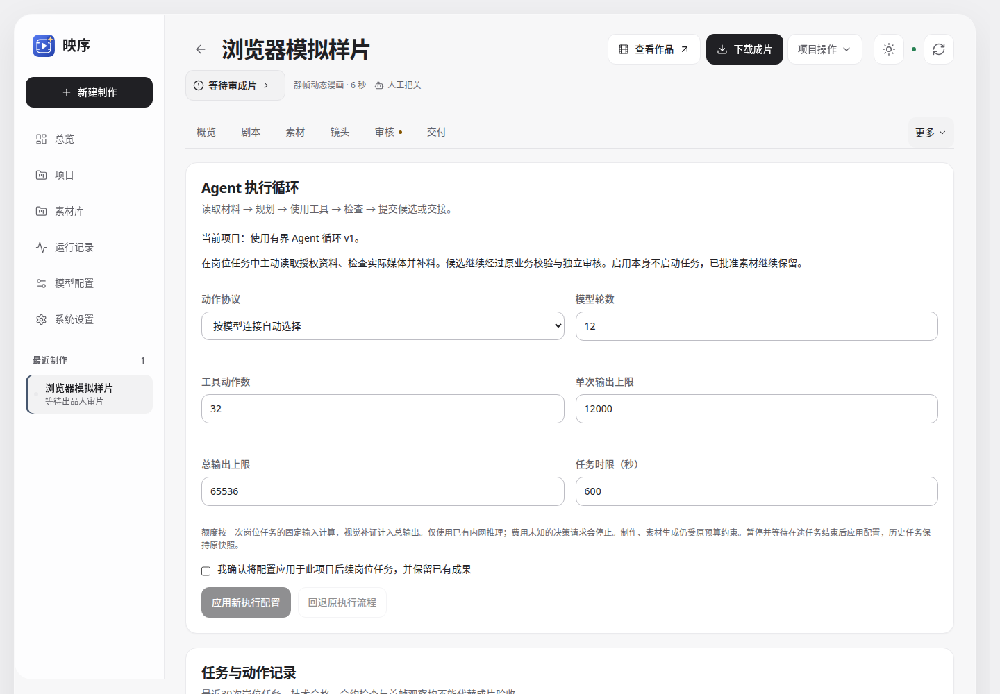
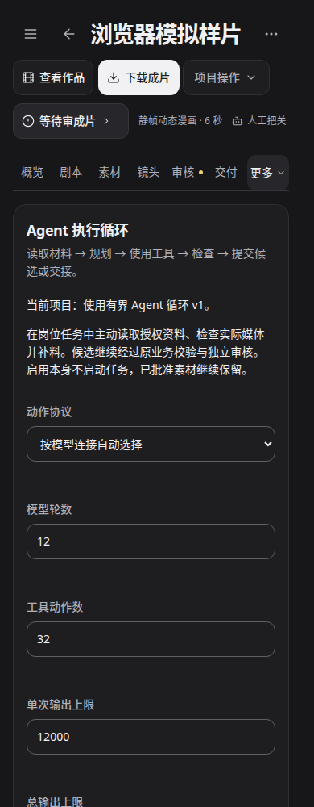

# 0.2.3 Agent 执行循环（阶段四）

关联 [#57](https://github.com/Xiiiing/ai-studio/issues/57)、[#78](https://github.com/Xiiiing/ai-studio/issues/78)。依赖阶段三 #77，以及已实测的 0.1.7 交接 #73 / #59；本分支合入该依赖的已验收提交，不替代其开发归属或授权合并它。推荐合入顺序：#72 → #75 → #77，#73，然后本阶段。

## 使用与验收

项目“更多 → Agent 执行循环”、整剧“项目资料 → Agent 执行循环”、长集的同名页均可配置。暂停并等待在途任务结束，确认后启用。此操作只创建项目快照，不启动模型；使用原“继续制作”入口运行。子项目创建时继承父快照，已有子项目独立应用。

1. 原项目默认沿用原执行流程，未运行的岗位不展示执行证据。启用后可设置原生工具/结构化动作、模型轮数、动作数、单次及总输出、时限；岗位预检不连接模型。
2. 从原制作入口继续。任务页展示当次额度、计划、动作、明确停止原因及来源哈希；候选提交仍需原业务校验与独立审核。
3. 执行中暂停、恢复：已保存的模型响应、读取及候选继续使用；不会重新请求已保存的模型结果。输入、提示词快照、模型或工具实现改变进入缓存身份；迟到的版本、租约或像素结果不能发布。
4. 导演可将具体镜头退回编剧补料。分步执行图保留请求，下一轮仅采用指定镜头变化；标题、人物及其他镜头保留，导演复验并继续独立审稿。范围不明、外部材料或锁定成果需要出品人处理，不虚构自动修复。
5. 结果未知时停止新增决策请求，保留原回执。确认供应商/服务状态后，在本页结束未知请求，再显式应用新配置；不会重投原请求。接口重试复用同一操作编号。
6. 在桌面、390px、320px和明暗模式查看配置、展开动作、查看候选与来源、处理未知状态。页面注明合成协议样例，不能作为真实模型或成片效果证据。

## 执行边界

保留 LangGraph、worker、任务账本及模型连接。`schemas.cached_json_call` 在岗位实际模型任务边界分派：未启用时保持原调用/缓存；启用后由固定控制器循环返回原输出合约的候选。它不是独立调度器，没有 Shell、URL、任意文件、生成收费媒体、解锁、批准或发布工具。

工具为 `read_material`、`plan`、`inspect_media`、`draft_artifact`、`check_artifact`、`submit_artifact`、`request_supplement`。原生调用和 JSON 动作使用同一合约校验及执行器；独立资料可一次请求多个读取，修改动作逐项执行。工具输出与参考资料仅作为数据。

用户硬要求、删除项、批准设定和当前任务输入始终随请求保留；其他授权材料按来源哈希检索、无损分页。上下文计入工具定义、历史响应和必需的协议字段，超限明确停止并请求拆分。不会以静默截断必需资料来通过检查。原生调用使用保守字节估算，结果页标明额度消耗，不能把它当作准确的供应商费用。

`inspect_media` 仅接受当前项目已登记、哈希匹配的媒体。文本岗位交给配置的视觉岗位读取实际像素；视频技术检查后提取真实首帧。它只能产生首帧观察，不证明跨帧动作完成、整片质量或批准状态；冲突观察保持为冲突。最终仍由原审核流程接收。

决策及视觉补证暂限已有内网 llama.cpp / Ollama native 连接，拒绝费用不明的供应商决策提交。收费媒体沿用原授权。项目级多供应商费用授权属于阶段七。单任务上限为默认12轮、32动作、12000单次输出、65536总输出、600秒；视觉补证纳入同一总量。超限、无进展、能力不足和未知结果保留已有成果并停止。时限为从该冻结任务开始的墙钟期限，暂停不会延长授权。

## 协议与恢复

原生工具适配 OpenAI Chat Completions 兼容协议及 Ollama native；自动模式对其他现有文本协议使用结构化动作。实际请求仍须通过费用/内网边界。不会在原生请求失败后偷偷改用另一协议重发。DeepSeek 协议实现保留所有先前 assistant 的 `reasoning_content`，Ollama 保留 `thinking`、转换参数对象与工具结果；原始推理只在私有请求历史中保存，公开时间线只显示显式计划、动作和结果。

每个项目的 `planning/agent-runs/journal.sqlite3` 保存动作、候选、额度及恢复状态；每次请求先写意图，响应和工具结果原子落盘，提交使用已检查候选的精确哈希。文件锁隔离同一任务，并沿用 worker 租约和业务版本检查；工具结果恢复不重复计额度。未知请求跨任务及配置切换阻止新增决策。

Agent 缓存记录单独的 `agent_origin`。复用时验证控制器产物身份、内容哈希及媒体当前字节，记录 `verified_agent_artifact`；不会把复用记录伪装成一次模型调用。每轮实际模型调用继续写模型回执、输入清单、任务账本与交接观察。提示词工作台可查看每轮装配及工具合约，候选页可查看输出合约和材料哈希；原始历史按私有文件留存。

## 验证范围与限制

自动测试使用固定响应，覆盖两种协议、六类冻结语料的输入保留、真实图片字节委托、补料及局部返修、暂停恢复、迟到响应、缓存身份、额度、未知结果和 HTTP 边界。浏览器使用明确标记的合成记录。真实模型质量比较仍需用户选择样例与预算，未运行时不宣称作品改善；独立审核闭环、可配置专业团队及自动终稿分别继续在阶段五至七实现。

参考机制：[Claude 子代理职责隔离](https://code.claude.com/docs/en/sub-agents)、[Codex 工具与上下文](https://developers.openai.com/cookbook/examples/gpt-5/codex_prompting_guide)、[Pi 事件与工具执行](https://raw.githubusercontent.com/badlogic/pi-mono/main/packages/agent/README.md)、[DeepSeek 思考模式与工具协议](https://api-docs.deepseek.com/guides/thinking_mode/)。借鉴执行边界与协议约束，未安装或声称运行这些宿主 Agent。

## 接口

- `GET /api/factory/projects/{id}/agent-loop`：快照、只读预检、最近任务与全部未知请求；`/{run_sha256}` 查看候选、输出合约、材料哈希与交接。
- `POST .../agent-loop`：`request_id`、`expected_revision`、`enabled`、`confirmed: true`、`settings`。只允许空闲且无结果未知的项目；操作编号幂等。
- `POST .../agent-loop/settle`：`request_id`、`expected_revision`、`run_id`、`confirmed: true`。人工核实后结束未知请求，不启动模型、不修改原回执。

