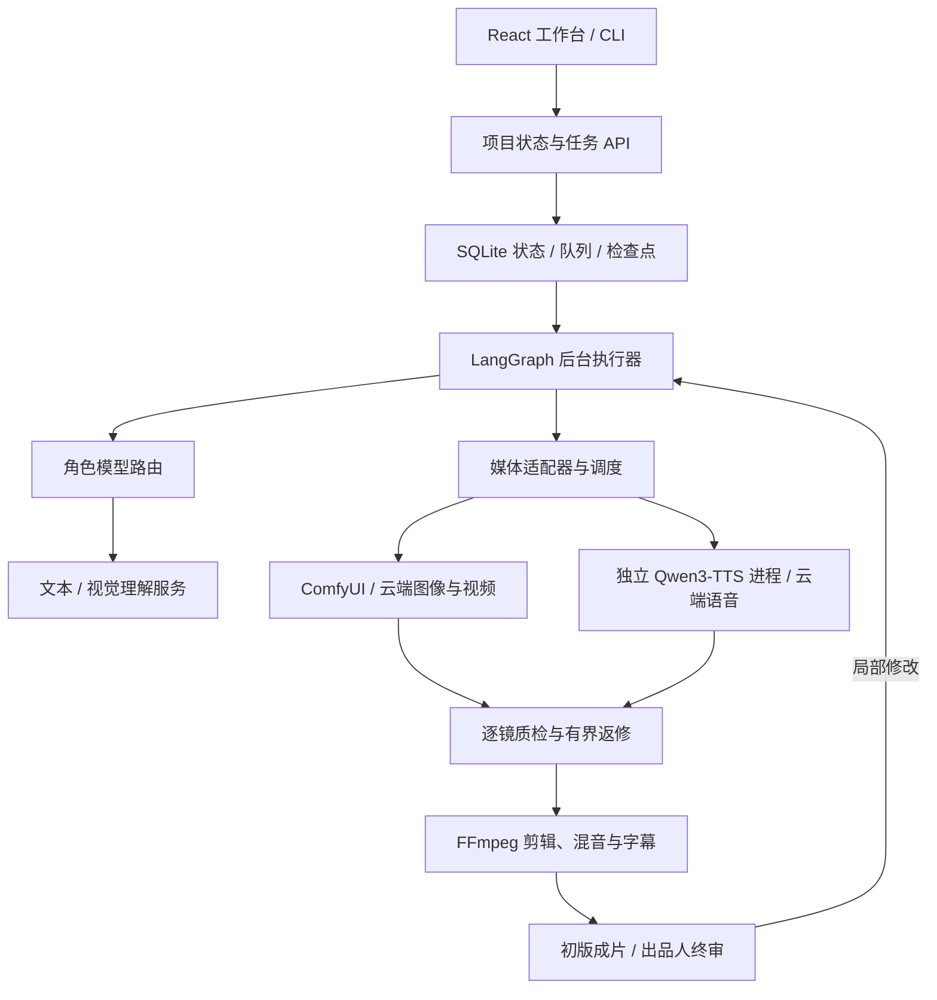

# 架构与目录导览

[项目首页](../README.md) · [文档中心](README.md) · [开发与验证](../CONTRIBUTING.md)

AI Studio 以一份持久化项目状态连接创作、人工决策、媒体任务与交付。工作台和 CLI 调用相同业务层；UI 负责展示与操作，不独立推进另一套制作流程。

## 控制层与制作资源

控制层是 Python Web 服务、后台 worker 和 SQLite；生产 UI 是由 Python 同源提供的静态资源，运行服务器不需要独立 Node 服务。LLM 权重由外部模型服务管理，不加载进 Web 进程。ComfyUI 可由制作端管理，也可连接用户已经运行的服务；Qwen3-TTS 本地路线使用独立环境中的受控进程，不假定存在通用远程 TTS HTTP API。

单机、自建局域网服务和全 API 路线使用同样的角色/连接配置。具体服务在哪台机器、是否由适配器启动，取决于部署方案。仓库中的 cami/Wkp 文档记录特定环境的实现与历史；不能用它们推断新安装的依赖、当前服务器状态或访问权限。

## 状态与恢复边界

- **角色与模型分离**：角色表达职责；连接配置表达协议、地址、模型 ID、能力和密钥变量。角色共用模型时仍明确记录。
- **项目固定执行版本**：新项目保存执行图版本，旧项目沿原检查点恢复；`./drama workflow --json` 可查看实际定义。它不是导入任意代码的工作流编辑器。
- **任务与人工决策持久化**：页面关闭后 worker 继续处理；故事、视觉、审核、费用授权和终审都有对应的状态与动作契约。
- **按镜头追踪**：参考图、提示词、模型身份、参数、外部任务 ID、质检与返修回执关联到制作版本；仍有效的素材可以复用。
- **外部任务保留身份**：已获取任务 ID 的视频恢复查询与下载。请求结果未知时不自动重复付费提交，见[用户模型指南](USER_MODELS.md)。
- **观察与实际调用分开**：团队卡展示当前绑定，历史回执保存当次模型；目录探测、配置预检、模拟验收和真实模型生成分别说明。

## 源码职责

| 位置 | 职责 |
| --- | --- |
| [`factory/providers.py`](../factory/providers.py) | 文本模型协议、连接目录、网络范围、配置校验与保存 |
| [`factory/llm.py`](../factory/llm.py) | 角色调用、结构化输出、上下文预算、执行回执 |
| [`factory/workflows.py`](../factory/workflows.py) | 持久化执行图与人工决策 |
| [`factory/creative.py`](../factory/creative.py) · [`factory/storyboard.py`](../factory/storyboard.py) | 编剧、独立评审、分镜与反馈处理 |
| [`factory/production.py`](../factory/production.py) · [`factory/scheduler.py`](../factory/scheduler.py) | 镜头制作、GPU 租约、预算与失败恢复 |
| [`factory/video_providers.py`](../factory/video_providers.py) · [`factory/video_transport.py`](../factory/video_transport.py) | 视频连接配置、网络和传输边界 |
| [`factory/minimax_video.py`](../factory/minimax_video.py) · [`factory/video_production.py`](../factory/video_production.py) | MiniMax 持久化视频任务与逐镜生产接入 |
| [`factory/team_flow.py`](../factory/team_flow.py) | 当前分工、产物流转与历史回执投影 |
| [`factory/web.py`](../factory/web.py) · [`factory/worker.py`](../factory/worker.py) | HTTP 服务与后台任务入口 |
| [`ui/factory/`](../ui/factory/) | React、TypeScript、Vite 工作台 |
| [`studio/`](../studio/) · [`audio/`](../audio/) | 媒体制作、剪辑、配音及来源回执 |
| [`nodes/`](../nodes/) · [`workflows/`](../workflows/) | ComfyUI 本地节点与制作参数模板 |
| [`planner/`](../planner/) · [`lipsync/`](../lipsync/) | 既有规划工具与可选口型适配；不是默认路线的完整安装包 |
| [`config/`](../config/) | 公开示例与被忽略的本机私有配置 |
| [`scripts/`](../scripts/) · [`deploy/`](../deploy/) | 初始化、服务模板、验收与环境相关运维工具 |
| [`tests/`](../tests/) · [`evaluation/`](../evaluation/) | CPU、UI、浏览器契约与离线创作评估 |

## 文件整理原则

源码、公开示例、产品文档和必要展示资源进入 Git；模型权重、环境、数据库、私有配置、生成素材和常规运行截图留在忽略目录。`.gitignore` 是实际规则，新增私有路径需同步核对。

文档通过[统一索引](README.md)分层组织，既有文件路径保留，避免外部链接、脚本或历史 PR 断链。README 负责介绍与引导；操作放入使用指南，具体接口放入模型/API 文档，特定环境与历史证据在索引中单列。新增资源需有来源、用途与维护方式，见[品牌资源说明](assets/README.md)。

部署细节见 [DEPLOYMENT.md](DEPLOYMENT.md)；可配置连接与网络约束见 [MODEL_PROVIDERS.md](MODEL_PROVIDERS.md)；原理参考及采用范围见 [REFERENCE_ARCHITECTURES.md](REFERENCE_ARCHITECTURES.md)。
