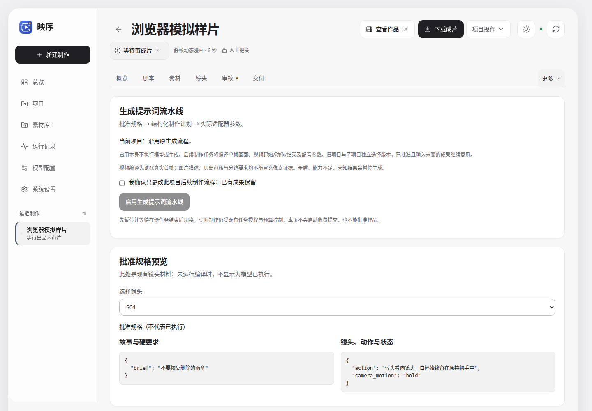
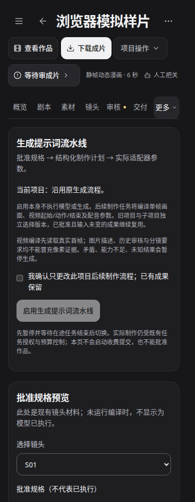

# 生成提示词流水线（0.2.2）

关联 [#76](https://github.com/Xiiiing/ai-studio/issues/76)，基于第二阶段 [PR #75](https://github.com/Xiiiing/ai-studio/pull/75) 的已实测提交。第三阶段自动验证与用户实测分别记录，不代表已审核、合并或更新稳定版。

## 启用与验收

制作单元打开 **更多 → 生成提示词流水线**；整剧打开 **项目资料 → 生成提示词流水线**；长剧集可直接选择同名页签。项目资料是父级快照，已存在的子项目不随父项目切换，实际制作请在对应制作单元中确认版本。

1. 在页面预览当前批准的故事、镜头动作、人物和道具状态。规格不是模型运行证据；不符合当前编译规格的历史镜头单独显示原因，不改写原项目。
2. 暂停项目，等待排队、运行、素材及未解决的云端提交结束。勾选确认后启用 v1。启用不会创建制作任务或调用模型，也不会重做已批准素材。可以用同样方式回退原流程。
3. 后续按原入口执行制作或定向返修。没有已批准镜头、真实首帧或适用模型时先补齐材料。已有有效结果继续使用；只有新生成或明确要求返修的目标进入编译。
4. 在页面检查结构化计划、实际引用 SHA256、首帧像素观察、编译参数，以及包含 seed 和确定性返修要求的精确请求准备记录。请求准备不是供应商受理、生成成功或质量通过的证明，执行结果沿用原任务、素材及费用回执。
5. 检查起始画面只有一个瞬间，视频计划明确起始状态、动作和结束状态；批准动作与运镜原文必须保留。首帧发生变化、与批准状态矛盾、观察不确定或缺少必要角色可见证据时，应停止视频编译。
6. 漫画运镜使用实际 FFmpeg 能力，只能从静图产生运镜。它不能完成转头、递物等人物表演；明确要求这些动作时必须选择可生成视频的媒介或修订批准分镜。不能靠相机移动通过动作验收。
7. 模型返回未知或进程中断时，保留原意图并停止新增编译。先核实服务端回执，再在页面确认结束未知编译，之后显式重新启用以形成新的选择快照。结束操作本身不会重投模型。浏览器响应中断时重试使用原请求 ID，避免重复更改配置。

## 编译和实际执行边界

- **锁定输入**：故事目标、最新反馈、批准分镜、人物/道具状态、对白、实际参考素材及绑定、风格、提示词与流水线快照。参考像素 SHA256、模型/工具配置、适配器能力及实现版本进入编译缓存身份。运行中的任务不能通过配置页切换版本；新创建的子项目继承当时父快照。
- **图像**：`storyboard_director@4.0.0` 生成闭合结构的计划，只描述起始瞬间。编译后的文本进入现有图像生成请求；参考数量按 Qwen、本地图、百炼模型或已导入工作流的实际槽位验证，分辨率使用生产执行器的实际值。
- **视频**：`visual_critic@1.0.0` 先读取适配器将使用的真实首帧像素，并可读取明确标注的角色身份参考。身份参考不能冒充目标首帧持物、姿态或位置证据。观察不能批准剧情更改或整片质量。随后分镜导演编译起始、动作、结束和相机要求；H3 使用时间线格式，其他生成视频使用其现有请求协议；MiniMax 保留供应商时长、分辨率与优化器配置。当前均使用外部配音，不承诺原生声音或同步口型。
- **配音**：只编译已批准台词、说话者与现有声线绑定；不改写台词，不向 TTS 注入不支持的导演描述。记录提供的实际声线参数，复用旧的成功语音缓存。
- **返修**：保持原有有限次数、任务账本、技术及语义审核。确定性返修要求进入精确请求准备回执；H3 的编译前缀不被覆盖。需要换首帧的返修先停止视频，要求定向修订并确认图片，再观察新像素，不能偷偷用另一张图继续旧计划。
- **恢复与证据**：完成的编译按身份复用，在途媒体任务复用其冻结计划；像素在观察期间或生成前变化时停止。失败和未知意图均保留，修改输入不能绕过未知结果锁。最近300份完成记录和全部未解决状态供页面查看；完整文件保存在本实例的 `production/factory-*/planning/generation-pipeline`。实际付费媒体提交仍由原队列、授权及费用账本控制。

原有 `storyboard_director@1.1.0`、H3 `3.1.0` 和旧项目执行路径保留，新合约可在第二阶段工作台独立编辑和验证。启用新流水线不会将旧记录补写为新版调用，不会更改公共模板。新版源文件进入第一阶段冻结身份，因此同一输入后续比较可以识别实现差异。

## 验证与效果限制

CPU/协议验证覆盖：动作丢失、顺序事件进入静图、首帧矛盾及不确定、原持物手、真实像素交付、参考图变化、已删除材料与新反馈缓存失效、媒介能力、静帧运镜冒充动作、配音原文与声线、未知结果不重投、版本切换、迟到像素变化、冻结计划恢复及有效旧素材复用。真实 HTTP 与浏览器验证配置确认、错误、规格/证据区分和明暗/手机布局。

模型协议测试和截图使用明确的合成样例，不能证明真实成片改善。本次不自动启动真实模型或付费生成；真实质量比较继续由用户选择代表项目、模型及预算后运行，保留失败及退步样本。后续独立审核、自动返修调度和项目级预算授权按后续阶段交付。

