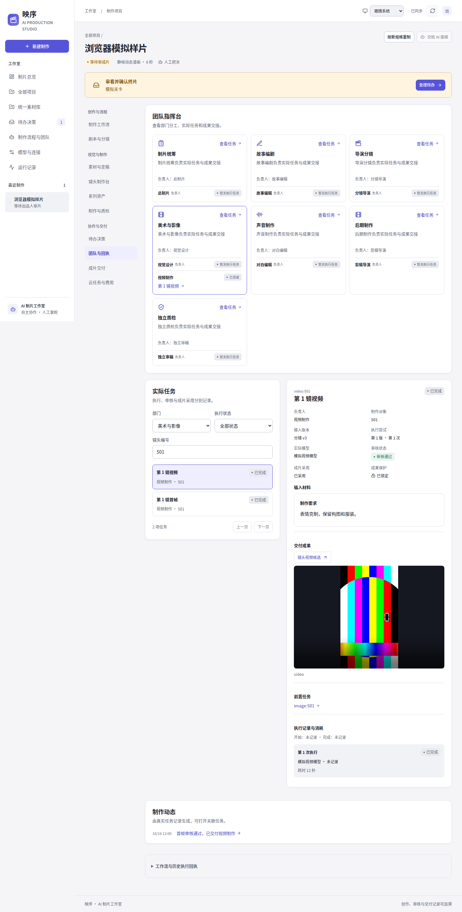
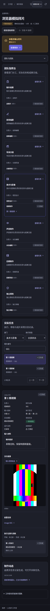
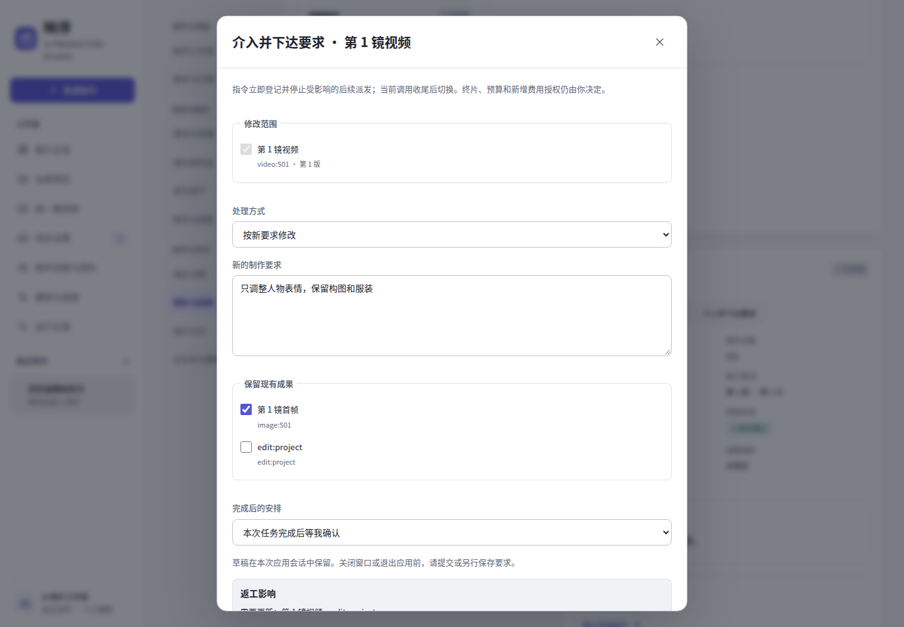
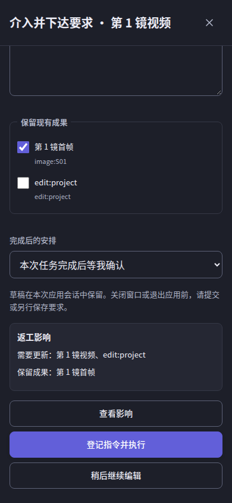
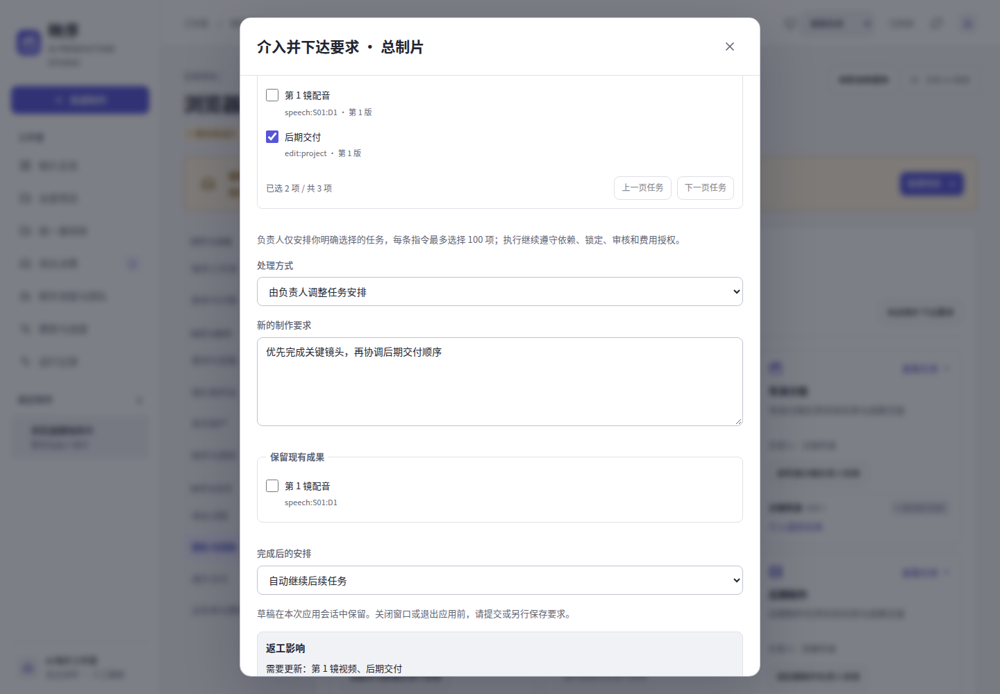
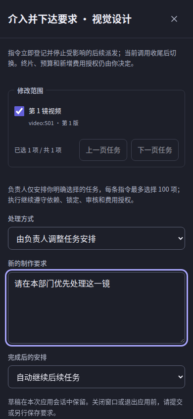
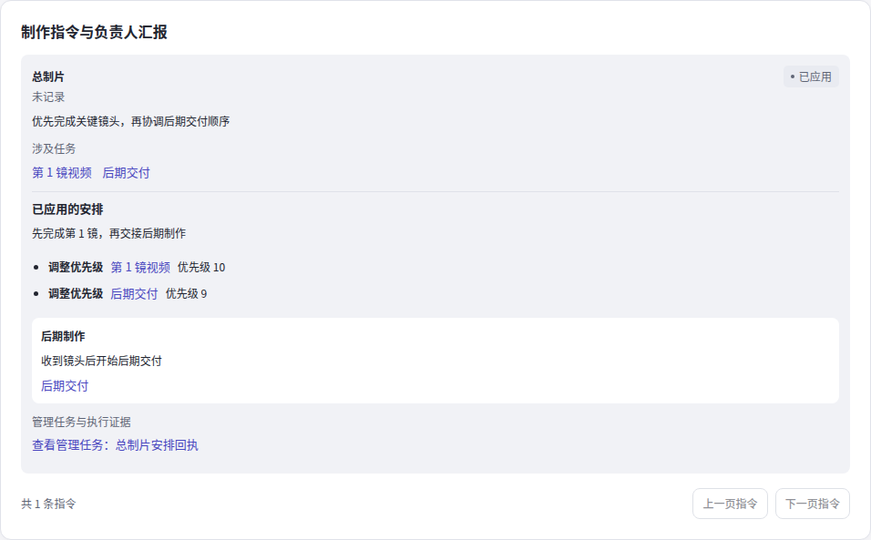

# 0.1.0 · 可介入的 AI 制作团队

本轮由 Issue #37 管理，沿 UI #35 的成果开发，合并顺序为 UI #33、#35，再依次合入三个团队 PR。模型接入 #34 不在本轮差异中。本文描述源码与隔离验证，不代表已合并或部署。

## 第一阶段：任务账本与团队指挥台

新增七部门、稳定岗位身份和持久化制作任务；模型配置与历史实际执行身份分别表达。任务详情展示实际输入、产物、独立审核、采用状态、依赖与尝试。团队读取接口不启动模型、不写任务、不补造旧历史。

新建 v2 项目启用任务账本；已有 v1/v2 无控制标识时保持既有执行和观察能力。工作流阶段仍由 LangGraph 执行；生产适配器在真实图像、视频、审核、配音、对白时长、剪辑与技术检查边界记录任务。已有有效素材标为复用，不生成执行次数或新时间。配音共享一个推理批次时逐句记录实际成果，并明确共享批次边界。

当前阶段保持原有执行顺序。生成完成、独立审核通过与人工采用分别表达。迟到的已失效尝试保存历史成果、模型与外部回执，但不能覆盖当前任务。

### 读取接口

- `GET /api/factory/projects/{id}/team`：部门、成员、任务概况与真实制作动态。
- `GET /api/factory/projects/{id}/tasks`：`offset`、`limit`（1–100）、`department`、`status`、`shot_id` 服务端筛选与分页。
- `GET /api/factory/projects/{id}/tasks/{kind:scope}`：稳定任务身份、版本与最近尝试。

SQLite 增加 `team_control`、`team_work_items`、`team_unit_attempts`。备份支持新表，仍接受尚无团队表的旧数据。阶段一不提供未接入执行的控制按钮。

### 验证

使用独立 SQLite、真实 loopback HTTP、CPU 合成图像/WAV/视频及模拟模型，不调用 Wkp 或收费接口。专项测试覆盖只读无写入、旧项目、稳定身份、版本隔离、迟到回执、模型来源、生产入口与缓存复用。UI 单元测试、类型检查和构建通过；Chromium 操作桌面/手机浅深主题，验证筛选、任务/依赖/动态定位及刷新保持媒体播放。

浏览器合成界面证据位于 `runtime/browser-report/team-console-{light,dark}-{desktop,mobile}.png`，CI 可保存报告。实际模型与生产服务器验证尚未进行。

以下是浏览器合成 fixture 的界面截图，内容不代表生产项目或真实模型结果：

## 第二阶段：介入与成果保护

在任务或成员入口选择明确任务，填写新要求或选择重新生成；可预览依赖影响、指定保留成果，并选择自动继续或完成后等待。指令与任务操作使用独立 `control_revision`、任务 `generation` 和幂等编号，普通进度刷新不会使编辑失效。相同指令重试不会重复登记或应用。

指令立即阻止新的旧安排派发；当前本地/供应商调用完成后保存尝试文件、原始成果和费用，再切换。已提交的异步云任务继续按原 ID 查询和下载，不能通过新参数重发。受影响旧成果不可成为当前选片。worker 释放旧租约后应用指令，崩溃恢复仍使用原队列与供应商身份。

任务支持暂停/恢复、锁定/解锁、完成后等待/确认继续。锁定绑定具体成果与制作输入；原有镜头、素材和 CLI 修改也通过同一写入保护。已审核剧本镜头、对白正文、已固定场景参考可分别锁定。已通过的镜头或配音保留原版本，返工按实际依赖传递，成片保留历史并重新终审。

直接图像/视频要求进入对应提示词；配音要求进入 Qwen3-TTS 的逐句情绪指令，显式同文本重做使用新的受控 seed。云端配音同文本重试有独立请求身份，仍须原费用流程授权；当前云端接口不支持的逐句情绪修改会交回处理，不伪称生效。创作要求进入实际模型请求与缓存签名，明确重做不会误用旧缓存。

团队控制启用时按逐句边界执行配音，保证单句介入不重做其他句。已有远程调用、费用不重置；此前无控制标识的 v2 项目仅在安全边界显式启用，导入成果先核对实际文件与 SHA-256。v1 不改写检查点。

### 控制接口

- `POST /projects/{id}/team/actions`：`enable`。
- `POST /projects/{id}/tasks/{task}/actions`：`pause`、`resume`、`lock`、`unlock`、`hold_after`、`release`。
- `POST /projects/{id}/interventions/preview`：只读依赖影响与锁定/保留冲突。
- `POST /projects/{id}/interventions`：登记任务或成员指令；`GET` 支持分页读取。
- `POST /projects/{id}/interventions/{instruction}/dismiss`：撤回尚未应用的指令。

以上路径均以 `/api/factory` 开头。任务动作要求 `request_id`、`expected_control_revision`、`expected_generation`。指令额外包含明确的 `target_type`/`target_id`、`task_ids`/`task_generations`、`instruction`、`operation`、`preserve` 和 `after`。服务端返回可执行动作，UI 不提供未接入的控制。

第二阶段尚不启用部门/总制片的模型重排入口；第三阶段完成结构化安排与实际调度后再提供。

第二阶段隔离验证：全量 Python 1523 项通过；检查发现的异步云任务范围隔离已修复，包含该场景在内的 113 项团队/云端专项全部通过。UI 全量 160 项、类型检查与构建通过，7 项相关 Chromium（包含真实 Python HTTP 项目页）通过。开发自查检查了以下模拟介入界面：

第二阶段后续自查修复了锁定成果复查与新生成的边界：配音重做可以保留锁定首帧及视频，视频内部返修也必须遵守首帧锁定。另将待处理指令解除冲突后的目标版本随规划占用一起落盘，进程中断恢复不会再次增加返工版本。阶段二分支上的相关任务控制和真实合成生产测试 45 项通过。

## 第三阶段：层级安排与自动执行

总制片入口可以选择跨部门的现有任务；部门负责人入口只读取本部门的任务。每条指令最多明确选择 100 项，保留打开编辑时的任务版本，默认由负责人调整安排，也可要求重做或修改。负责人模型必须有明确且启用的绑定；未配置时显示不可用原因，不借用其他角色的隐式配置。总制片暂不可用时，已经配置的部门负责人仍可独立接收本部门指令。

总制片把明确范围交给对应部门负责人，各负责人以独立的 2.0.0 管理提示词输出结构化安排。控制器校验现有任务、原始版本、能力匹配、依赖、锁定、保留项和费用边界后应用优先级、暂停、恢复、转派或返工。管理角色不能新建任意制作节点、改审核结论、增加预算或批准终片。无法应用的安排保留原要求和原因，交回处理。

任务调度实际采用新的优先级；尚未完成的前置任务继承交付任务的有效优先级，依赖仍须满足。可转派成员来自现有岗位的能力集合：独立审稿不交给编剧，图像、视频、配音等工具任务没有其他合格执行者时明确说明。创作阶段转派同时改变实际模型路由、团队工单与工作流负责人，不修改全局模型绑定。已记录的实际模型保持原始身份。

`GET /team` 额外返回部门 `management_available` / `management_unavailable_reason`、负责人 `leader_available` / `leader_unavailable_reason` 及总制片 `replan` 能力。任务读取增加 `allowed_owners`、`default_owner`、`assignment_reason` 与 `effective_priority`。指令沿用第二阶段接口，通过 `target_type=leader`、明确的 `target_id` 和 `operation=replan` 发起，仍受原始任务版本与控制版本保护。

制作指令分页展示原要求、登记／安排／已应用／待处理状态、结构化操作、部门交接和关联任务。`plan.management_tasks` 指向真实管理执行任务，可打开请求、回执和当次实际模型。编辑期间负责人变得不可用时，草稿继续保留，提交停止；刷新和切换项目页面也不会静默重置原要求。

第三阶段 UI 隔离验证：团队与工作流专项 27 项单元测试、类型检查和构建通过；3 项专用 Chromium 场景覆盖全部三阶段，包含跨部门与部门范围、不可用负责人、实际管理任务证据、草稿恢复、版本冲突和媒体刷新连续性。Python 只读投影、安排、账本、角色交接、工作流与操作台专项共 112 项通过，包含数据库无写入、有效优先级、负责人可用性与转派身份一致性；其余执行链路验证由集成检查汇总。本轮没有调用真实模型、收费供应商或 Wkp 生产服务器。

以下截图均来自浏览器合成 fixture，不代表生产数据或真实模型生成结果：

## 最终集成验证

实现沿实时 main 同步已合并的 UI #35 与阶段一 #39；阶段二 #41 以 main 为目标，阶段三以阶段二分支为比较基线，依次合入。未混入 #34，未合并或部署后续 PR。

- 全量 `python -m pytest -q tests/test_factory_*.py`：1570 项通过。之后对规划占用时保存恢复版本的修复，在阶段二分支跑 45 项控制/合成生产测试，在最终集成分支跑 180 项团队/Prompt/模型路由测试，均通过。
- `npm test`：165 项通过；`npm run build`：类型检查与生产构建通过。
- `TEST_PORT=18789 npm run test:browser`：73 项 Chromium 场景通过，包含真实 Python loopback HTTP、桌面/手机浅深主题、键盘焦点、错误重试、草稿和媒体播放保持。已实际检查本页截图。
- 实际模拟生产证明高优先级镜头先完成其依赖，镜头时间线顺序不变；暂停镜头后其余镜头可继续，恢复复用已完成成果。
- 实际模拟生产证明逐句配音重做保留锁定首帧及视频的路径/SHA，其他配音回执不变，不新增图像生成；相关语义检查允许复查原画面。
- 已登记的异步任务从持久化供应商日志恢复，只下载原任务；旧成果进入 superseded 尝试，不成为当前选片。规划模型输出缓存之后中断，再恢复不重复请求或应用；解除冲突之后中断也不重复增加任务版本。

以上使用独立数据库、CPU 合成媒体和模拟模型/供应商。真实 Qwen3.8、Qwen3-TTS、MiniMax 与 Wkp 生产服务器验证尚未进行，费用授权、预算增加和终片确认仍由出品人决定。
