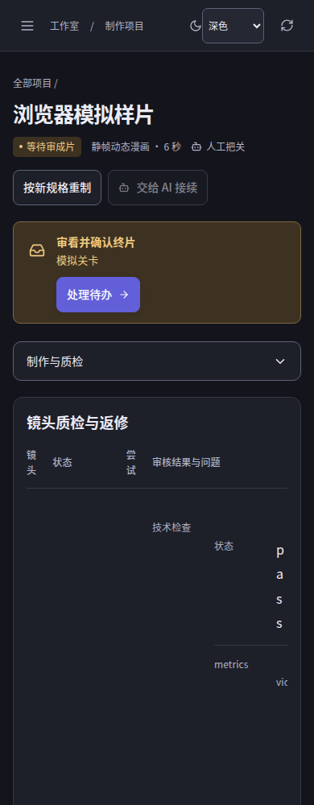
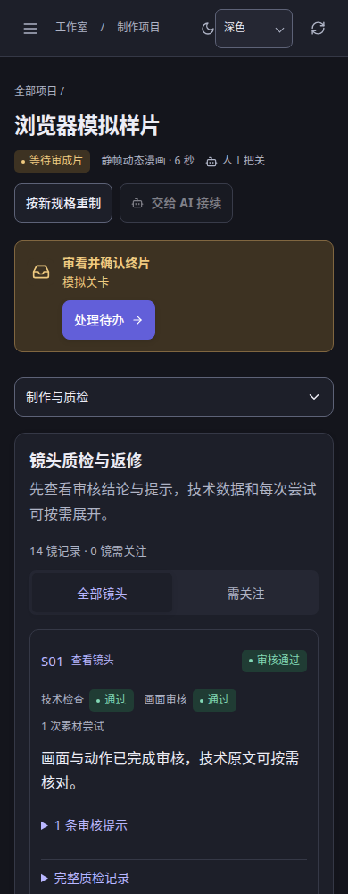
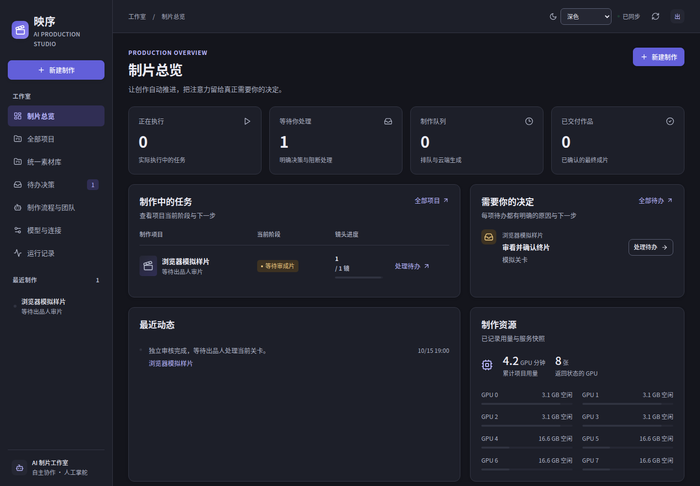
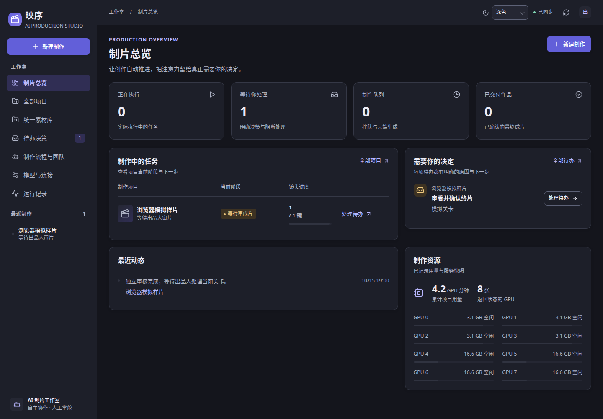

# 0.0.3｜部署后 UI 体验修正

## 实际问题与修复

本轮基于用户反馈检查 0.0.2 实际部署，继续关联 #31，以发布分支 `codex/ui-lan-release` 为比较基线。迭代标识为 **0.0.3**，独立 Python 后端版本保持不变。旧分支的 UI 原则保留，纠正实际业务数据暴露的内容层级与宽度问题。

已确认并修复：

- 手机四列质检表内再嵌套两列原始数据，技术指标被挤成逐字竖排。改为审核摘要卡、明确需关注筛选与逐镜入口；完整技术原文和尝试记录按需展开、支持键盘滚动，每页六镜。
- 剧本直接平铺完整技术对象、人物视觉提示与所有分镜。概要优先显示故事正文和人物中文姓名，视觉提示与完整结构保留原文入口，分镜每页六镜；嵌套键值在手机使用完整宽度。
- 团队的全部工单、职责、历史决定和调用被同时展开。当前任务先展示，历史工单和职责按需展开；所有未完成或失败的当前任务仍可见；调用按角色筛选和分页，轮询保留阅读器、原文模式与滚动。
- 1440px 下全局、项目、镜头三层侧栏挤走188px主内容。超宽屏保留项目分组侧栏，普通桌面使用常用页快切与完整页面菜单，平板提前进入抽屉。
- 手机项目菜单分组被拉成同高并推走正文。菜单改为锚定浮层，分组内容对齐，十个入口均保持44px；工作流详情和返回位置避开常驻导航。
- 镜头精修表单挡在作品前。先展示视频候选与作品，精修默认折叠，有草稿返回自动展开；播放器节点、进度与候选勾选继续保留。
- 手机配置修改后保存区在六屏外。仅存在草稿或保存中时提供吸底保存入口，保留重新载入确认和失败草稿，预留底部空间。
- 总览减少等高空面板、资源/作品/动态采用错落的内容网格；统一标题密度、品牌副标题、原生主题控件、占位文字和状态颜色，补齐业务字段与状态的中文映射。

实际已交付样本的390px只读复核：质检页从约121221px降到4688px，剧本从20472px降到6579px，团队从17613px降到4492px。这是固定样本的页面高度比较，不能代替所有业务状态验收。手机模型草稿保存条69px高，操作目标44px；页面顶部即可操作，底部字段不被遮挡。真实截图仅保存本地，不公开项目内容。

## 合成数据截图

以下比较只包含浏览器 fixtures，不包含真实项目、凭据或连接信息。

| 场景 | 修复前 | 修复后 |
| --- | --- | --- |
| 手机深色质检 |  |  |
| 桌面深色总览 |  |  |

## 验证边界

- 隔离 UI、浏览器和真实 Python HTTP fixtures 验证交互；不调用生产模型或收费接口。
- 浅/深主题全部17页面按320/390/768/1024/1440/1920px检查，补充高密度合成数据、质检筛选和分页、工单历史折叠、草稿/播放器连续性、菜单不推动内容、模型保存可达性。
- 真实 LAN 页面验证仅允许 GET/HEAD；部署前在浏览器替换本地构建资源读取真实API，部署后直接复核原入口。模型草稿只在浏览器内修改，不提交真实配置，不发起连接探测、生成或审批。
- 关键真实页面可见非禁用文本按合成背景扫描对比度，未发现普通字低于4.5、大字低于3；这不覆盖禁用控件、图像文字、全部展开原文和每个悬停状态。
- 本轮只部署静态UI，保留原Web/worker、H3路由、配置和数据库，不重启模型服务、不迁移数据。保留旧fingerprinted资源和入口文件备份以便回退。

本机验证：160 项 UI 测试通过；完整79项浏览器检查通过（包含17页面×6宽度×2主题的204组合），最后状态文案调整后针对团队、模型、密集数据和手机保存入口的15项再次通过；类型检查与生产构建通过。本次未改 Python 源码，沿用对应Web/worker版本；fixture中的真实HTTP与安全边界仍在完整浏览器检查中执行。

## 参考依据

本次按用户要求检索 GitHub，并通过官方仓库 API 读取实际源码。以下固定提交用于说明参考行为，避免默认分支后续变化影响核对。这里只借鉴交互和布局原则；没有引入这些项目的依赖、复制组件或替换映序品牌。

### shadcn/ui：导航和内容保持清晰的结构边界

参考提交：`c2477f311c19982ef6e246085438e6cfec3e35ea`。

- [Sidebar 实现](https://github.com/shadcn-ui/ui/blob/c2477f311c19982ef6e246085438e6cfec3e35ea/apps/v4/registry/new-york-v4/ui/sidebar.tsx)：桌面导航与手机抽屉使用不同的展开状态；手机渲染 Sheet，并提供可访问的标题与说明。桌面侧栏预留独立宽度，避免覆盖主内容。
- [Sidebar 07 页面组合](https://github.com/shadcn-ui/ui/blob/c2477f311c19982ef6e246085438e6cfec3e35ea/apps/v4/registry/new-york-v4/blocks/sidebar-07/page.tsx)：打开导航的按钮位于主内容头部，导航收起后仍可访问；头部、面包屑和内容分别组成结构层。
- [主题变量](https://github.com/shadcn-ui/ui/blob/c2477f311c19982ef6e246085438e6cfec3e35ea/apps/v4/app/globals.css)：背景、卡片、弹层、侧栏及其前景颜色成对定义。深色模式同时改变各表面与文字，组件通过语义变量取得颜色。

在本项目中的落实方向：`.topbar` 保留明显的手机导航入口；全局侧栏、项目导航和页面操作各自承担一层信息，不重复堆叠标题与按钮；`styles/tokens.css` 继续集中定义成对前景和表面色。手机导航的临时展开状态不写入主题或桌面布局偏好。

### Twenty：紧凑工作区与受约束的详情分栏

参考提交：`32825ec85468487654f03c98eb910647e9395517`。

- [MainAppLayoutWithSidePanel](https://github.com/twentyhq/twenty/blob/32825ec85468487654f03c98eb910647e9395517/packages/twenty-front/src/modules/app/components/MainAppLayoutWithSidePanel.tsx)：主行、主列及内容层都允许收缩，显式设置 `min-width: 0`、`min-height: 0`；桌面详情侧栏与手机命令面板使用不同呈现形态。
- [AppNavigationDrawer](https://github.com/twentyhq/twenty/blob/32825ec85468487654f03c98eb910647e9395517/packages/twenty-front/src/modules/navigation/components/AppNavigationDrawer.tsx)：当前源码在手机上使用导航首页和底部切换，省去桌面主导航抽屉。可借鉴的是按手机任务重排结构，而非缩小桌面界面；本项目已有抽屉契约，无需照搬其导航形式。
- [深色主题](https://github.com/twentyhq/twenty/blob/32825ec85468487654f03c98eb910647e9395517/packages/twenty-ui/src/theme/theme-dark.css)：使用多级中性背景、不同强度边框及分层文字；强调色主要承担状态与操作提示。

在本项目中的落实方向：为 `.project-content-layout`、`.project-tab-content`、`.workflow-layout`、`.workflow-inspector` 等嵌套布局保留可收缩空间，检查长名称、文档和媒体是否突破实际可用宽度；窄屏把“选择列表 → 详情 → 返回”做成明确流程。减少多重彩色背景和同等重量的大面板，先显示当前状态、作品和主操作。详情分栏是否成立应依据主内容实际宽度，而不仅依据窗口宽度。

### Plane：列表与详情共同组成一个工作区

参考提交：`ac0d55de30eb2876209016744e025c95647dffe4`。

- [InboxIssueRoot](https://github.com/makeplane/plane/blob/ac0d55de30eb2876209016744e025c95647dffe4/apps/web/components/inbox/root.tsx)：桌面同时呈现列表和详情；手机列表占据可用宽度，通过显式状态切换至详情，避免继续维持两窄列。
- [InboxSidebar](https://github.com/makeplane/plane/blob/ac0d55de30eb2876209016744e025c95647dffe4/apps/web/components/inbox/sidebar/root.tsx)：头部、筛选和列表分层；滚动区域归列表管理，并区分筛选无结果、业务空态与加载状态。表面和文本使用语义颜色。

在本项目中的落实方向：工作流、团队和文件阅读器的工具栏紧凑排列，列表与详情的滚动归属清楚；手机进入详情时保留返回入口、当前选择和阅读位置。项目列表的空态应说明“没有项目”还是“当前筛选无结果”，并提供对应主操作。不能为了紧凑而缩小手机文字或触控目标。

### 范围与许可

- shadcn/ui 使用 [MIT 许可](https://github.com/shadcn-ui/ui/blob/c2477f311c19982ef6e246085438e6cfec3e35ea/LICENSE.md)。本次未复制其组件源码；将来若引入实质源码，需要保留相应版权和许可声明。
- Plane 所读取的文件明确标注 `AGPL-3.0-only`，仓库许可见 [LICENSE.txt](https://github.com/makeplane/plane/blob/ac0d55de30eb2876209016744e025c95647dffe4/LICENSE.txt)。本次仅参考交互原则，不将其实现移入项目。
- Twenty 的 [根许可](https://github.com/twentyhq/twenty/blob/32825ec85468487654f03c98eb910647e9395517/LICENSE) 按目录区分 AGPL、商业文件和 MIT 包；所读取的应用布局位于 `twenty-front`，`twenty-ui` 则有独立的 [MIT 许可](https://github.com/twentyhq/twenty/blob/32825ec85468487654f03c98eb910647e9395517/packages/twenty-ui/LICENSE)。本次仅参考结构与主题分层，不复制应用实现。

参考实现不能替代映序实际页面验收。所有修正仍需在现有中文长文本、真实部署只读页面、隔离测试数据、浅色/深色及桌面/手机尺寸下验证，且保持既有业务动作和路由契约。
