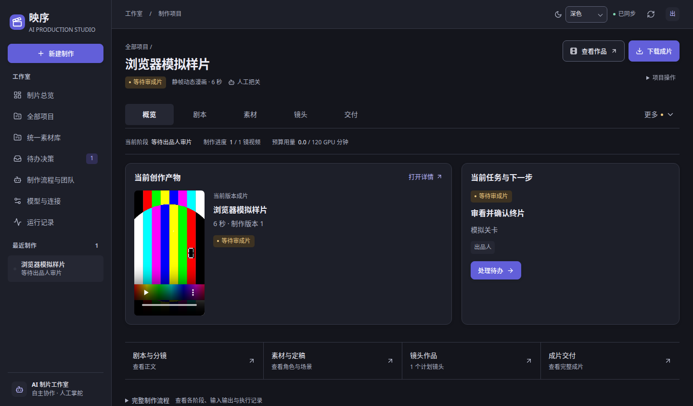
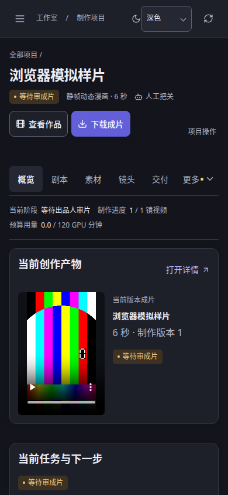
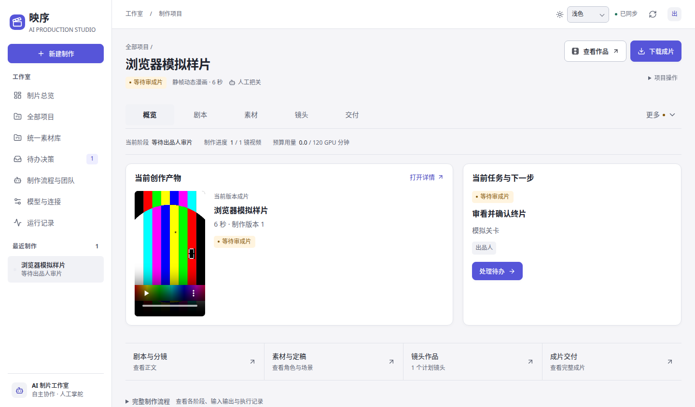
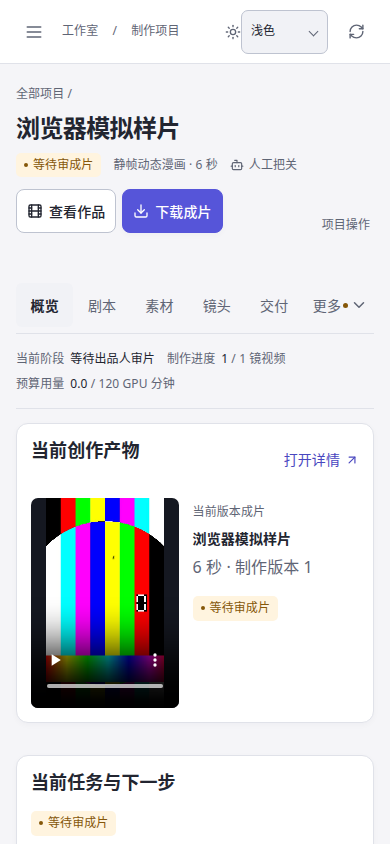

# 0.0.6｜项目成果与导出入口修正

关联 [Issue #45](https://github.com/Xiiiing/ai-studio/issues/45)，基于 `main@706c41fcc7ce7013863b3c9afa6668b4d6a95b98`。

## 问题与结果

原项目概览同时展示工作室侧栏、超宽屏项目侧栏、规格说明、指标和大型流程图，当前作品位于流程之后。下载仅在交付页播放器后出现。本地离线 fixtures 的 390×900 页面中，下载按钮位于约 1573px，标题区域没有直接查看与下载操作。这些坐标来自固定模拟数据，不能代表生产服务器或所有项目的现状。

本次调整：

- 所有宽度使用相同的五个常用项目入口：概览、剧本、素材、镜头、交付；“更多”保留全部十个页面，按创作制作、审核交付、项目管理分组。移除超宽屏第二列项目侧栏。窄屏工作室抽屉继续保持焦点约束与遮罩关闭行为。
- 项目标题旁固定提供“查看作品”和“下载成片”。已有当前项目合法视频时直接下载现有 MP4；尚无成片时禁用下载并显示原因，不创建空链接。查看优先定位成片、已有镜头、剧本或故事方案。
- 概览优先呈现当前作品、当前待办标题与处理入口，再提供各类成果的直达入口。没有成片时也可预览已生成的镜头。阶段、进度、预算收敛为一行摘要。
- 完整流程与制作规格、团队概况改为按需展开；流程首次展开才挂载，避免隐藏 SVG 动画无法启动。展开后收起保留已选步骤与阅读器节点。团队回执“定位步骤与记录”自动展开完整流程，并定位原有执行记录。
- 重制、人工接管与委托等操作收进“项目操作”，保持原动作契约及版本校验；支持 Escape 关闭并恢复焦点。
- 成片交付先显示视频与下载，规格和制作回执依据位于其后的可展开区域。
- 中性背景、边框和选中状态承担布局分区，品牌强调色用于主要操作；待办不再使用整块黄色横幅，流程返修节点不再铺满警告底色。状态标签保留文字和语义色。

没有更换底层模型、生产数据库或媒体存储，也没有增加转码、生成新成片或文档导出功能。下载复用已有成片及既有项目媒体校验。

## 实际参考的开源实现

读取并比较以下固定版本的官方源码，仅借鉴布局与操作组织方式；没有复制组件源码或引入相关依赖。

| 项目及固定版本 | 实际读取内容 | 本次借鉴 |
| --- | --- | --- |
| [OpenCut，pre-rewrite `238750c`](https://github.com/OpenCut-app/OpenCut/tree/238750c0250650f1254cf7a4738f8e8c8a0c268c) | [EditorHeader](https://github.com/OpenCut-app/OpenCut/blob/238750c0250650f1254cf7a4738f8e8c8a0c268c/apps/web/src/components/editor/editor-header.tsx)、[ExportButton](https://github.com/OpenCut-app/OpenCut/blob/238750c0250650f1254cf7a4738f8e8c8a0c268c/apps/web/src/components/editor/export-button.tsx) | 项目标题与导出同属工作区头部，次要项目操作收进菜单。当前主分支正重写，参考有完整 Web 编辑器的历史版本。 |
| [InvokeAI `861210e`](https://github.com/invoke-ai/InvokeAI/tree/861210e33fb3cea6dfd1eaf47b37bd82fe05afc7) | [ImageViewerToolbar](https://github.com/invoke-ai/InvokeAI/blob/861210e33fb3cea6dfd1eaf47b37bd82fe05afc7/invokeai/frontend/webv1/src/features/gallery/components/ImageViewer/ImageViewerToolbar.tsx)、[CanvasLaunchpadPanel](https://github.com/invoke-ai/InvokeAI/blob/861210e33fb3cea6dfd1eaf47b37bd82fe05afc7/invokeai/frontend/webv1/src/features/ui/layouts/CanvasLaunchpadPanel.tsx) | 查看器与当前作品操作集中，按媒体可用性提供适用操作，详细元数据按需显示。 |
| [shadcn/ui `c6bcc12`](https://github.com/shadcn-ui/ui/tree/c6bcc126efb9ffa28218f39a931b6cc572fa8473) | [Dashboard AppSidebar](https://github.com/shadcn-ui/ui/blob/c6bcc126efb9ffa28218f39a931b6cc572fa8473/apps/v4/app/%28app%29/examples/dashboard/components/app-sidebar.tsx)、[官方 Sidebar 文档](https://ui.shadcn.com/docs/components/sidebar) | 全局导航、主要页面、辅助管理分区；使用中性主题变量，避免重复侧栏挤占作品空间。 |

上游仓库分别声明 MIT、Apache-2.0、MIT；本次没有引入其源码，现有第三方依赖与许可清单不变。

## 可查看的界面证据

以下为当前代码运行后的真实浏览器截图，数据和色条视频来自独立离线 fixtures，不是生成模型或生产素材。

| 场景 | 截图 |
| --- | --- |
| 桌面深色 |  |
| 手机深色 |  |
| 桌面浅色 |  |
| 手机浅色 |  |

## 验证

最终集成验证：

- `npm test`：17 个测试文件、186 项 UI 检查通过。
- `npm run build`：TypeScript 类型检查和 Vite 生产构建通过。
- `TEST_PORT=18796 npm run test:browser`：完整 97 项浏览器检查通过，包括既有的 17 页面 × 6 宽度 × 2 主题共 204 个展示组合，以及本次新增的成果/下载交互检查。
- 320/390/768/1024/1440/1920px、浅/深主题直接检查首屏按钮与页面坐标；无需通过点击自动滚动掩盖位置。当前固定样本在 390×844 下，下载按钮顶部约 189px，当前作品区域顶部约 423px；桌面 1440×844 下分别约 84px、339px。
- 用真实浏览器下载现有成片，确认下载成功并检查 MP4 `ftyp` 文件头；覆盖未生成状态、长中文标题与合法媒体路径约束。
- 菜单横向和纵向边界、十个入口、Escape 与焦点恢复通过；流程首次展开的动画、收起后的选中步骤与阅读器节点保留、团队回执定位通过。
- 既有团队分派/介入/成果锁、镜头草稿、候选播放与轮询连续性、模型设置、素材工作台和真实 Python HTTP 临时服务检查通过。

以上结果来自同一份最终应用源码。早期检查发现的待办标题缺失、隐藏流程 SVG 动画与测试导航入口问题均已修正；最终完整回归通过。

验证使用本地独立 fixtures 和临时数据库。生产服务器、真实模型与真实生成质量不在本次验证范围；没有合并或部署。
