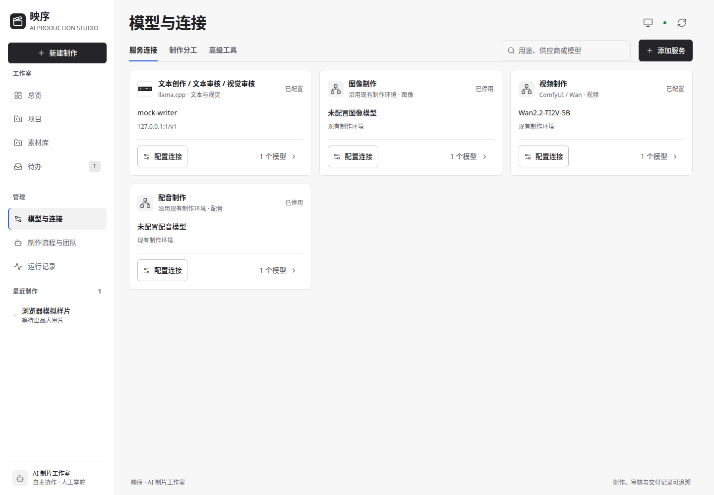
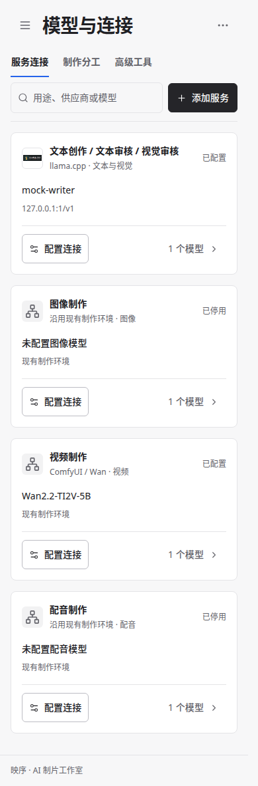

# 三轮 UI 前后对比

全部使用独立默认 fixtures、浅色主题、同一视口宽度与1000px高度；截图保留页面自然高度。模拟样片是合成色条，不是真实生产作品或模型效果。服务地址、项目内容均为测试数据。

修改前源码为 `80875ad`，修改后对应本轮共享页头、服务卡片及状态点的实现。模型页不展开详情，概览保持流程折叠，流程页保持默认选中项；配对截图没有额外服务或场景注入。

| 场景 | 桌面1440px | 手机390px |
| --- | --- | --- |
| 模型与连接 | [修改前](models-1440-before.png) / [修改后](models-1440-after.png) | [修改前](models-390-before.png) / [修改后](models-390-after.png) |
| 项目概览 | [修改前](project-overview-1440-before.png) / [修改后](project-overview-1440-after.png) | [修改前](project-overview-390-before.png) / [修改后](project-overview-390-after.png) |
| 全局流程 | [修改前](workflow-1440-before.png) / [修改后](workflow-1440-after.png) | [修改前](workflow-390-before.png) / [修改后](workflow-390-after.png) |

模型首卡顶部实测：1440px为141px，390px为199px，320px为203px；均低于180px桌面/220px手机的目标。卡片布局按容器而非视口计算，639/640/979/980px内容宽度依次为1/2/2/3列。全站六种视口与浅深主题的完整结果、错误/抽屉锚点稳定性和服务保存回归见[实现与验收说明](../../UI_REFINEMENT_ROUND3.md)。

正式服务器的截图含真实配置，只保留在服务器忽略目录，不放入此公共证据。

## 工作流状态专项

直接显示现有 fixtures 的流程节点，未向DOM注入展示组件。运行、审核和失败使用原场景；通过状态由独立模拟审批准备，再只读打开交付节点。两种主题的文字及底板保持中性，仅状态点及必要返修线保留语义色。

| 状态 | 浅色 | 深色 |
| --- | --- | --- |
| 执行中 | [蓝点](states/running-light.png) | [蓝点](states/running-dark.png) |
| 等待人工处理 | [琥珀点](states/review-light.png) | [琥珀点](states/review-dark.png) |
| 明确阻断 | [红点](states/failed-light.png) | [红点](states/failed-dark.png) |
| 已通过 | [绿点](states/success-light.png) | [绿点](states/success-dark.png) |

[布局实测数据](layout-metrics.json) · [四态实测数据](state-metrics.json)。专项与正式服务检查相互独立，没有触发真实项目审批、生成或恢复。
